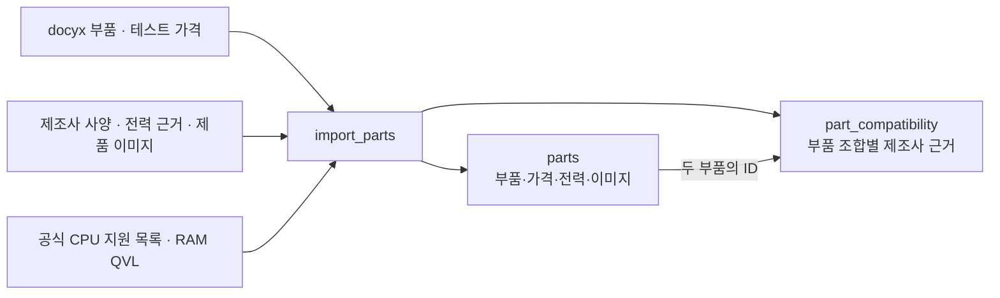
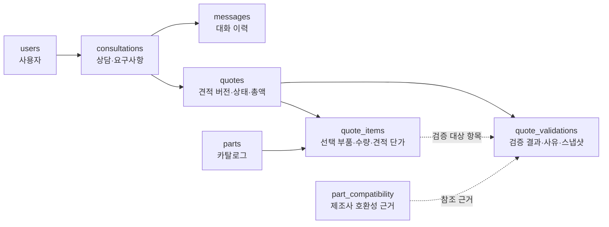

# 부품 DB 흐름

`dev_database`의 [현재 ERD](erd/schema.svg)는 8개 테이블의 저장 구조를 보여줍니다. 부품과 제조사 호환성 근거는 적재 명령으로 채웁니다. 상담에서 검증 결과 저장까지는 스키마가 지원하는 흐름이며, 현재 카탈로그 도구가 서비스에서 각 테이블을 자동으로 채우지는 않습니다.

현재 작업 트리에서 FastAPI 시작 검사는 기존 `app.db.models` 모듈 누락으로 실패합니다. 아래 상담·견적 흐름은 이 DB가 데이터를 저장하는 방법을 설명합니다. 별도 Mock 서비스의 과거 구조는 [아키텍처 문서](../ARCHITECTURE.md)에 있습니다.

## 부품과 호환성 데이터 적재

`import_parts --apply`가 부품을 먼저 저장하고, 양쪽 부품 ID가 확인된 호환성 근거를 같은 트랜잭션에 연결합니다. 전력과 이미지 갱신은 기존 부품 ID와 견적의 단가를 보존합니다. 새 부품에 저장하는 원본 가격은 KRW로 변환한 테스트용 스냅샷입니다. [적재와 점검 명령](README.md#빠른-사용)

## 상담에서 견적·검증까지

점선은 검증 결과가 선택적으로 연결하는 참조입니다. 견적 한 건에 항목과 검증 결과를 여러 개 연결할 수 있습니다. 실부품 스키마의 상태와 참조 제약은 [테이블 정의 SQL](../../backend/app/db/sql/parts_catalog.sql)에 있습니다.

## 기능별 테이블

| 기능 | 테이블 | 저장하거나 읽는 값 |
|---|---|---|
| 사용자 식별 | `users` | 사용자 ID, 표시 이름 |
| 상담 시작·요구사항 관리 | `consultations` | 사용자 ID, 상담 목적, 요구사항 JSON |
| 상담 내용 조회 | `messages` | 상담 ID, 발화자 역할, 메시지, 작성 시각 |
| 부품 검색·후보 선택 | `parts` | 분류, 모델, 사양, 기준 가격, 전력, 사진 URL 및 출처 |
| 제조사 호환성 확인 | `part_compatibility` | 메인보드–CPU 또는 메인보드–RAM 등의 부품 쌍, 지원 상태, BIOS·QVL 조건, 출처 |
| 견적 생성·상태 관리 | `quotes` | 상담 ID, 견적 버전, `DRAFT`·`CONFIRMED`·`ARCHIVED`, 총액 |
| 견적 상세·단가 보존 | `quote_items` | 견적 ID, 부품 ID, 수량, 선택 옵션, 당시 상품명·단가·가격 출처 |
| 검증 결과 보존 | `quote_validations` | 견적 버전, 검사 종류, 결과·사유, 입력·근거 스냅샷, 선택적인 대상 항목과 제조사 근거 ID |

부품 가격을 갱신한 이후에도 기존 견적의 당시 단가는 `quote_items.unit_price`에서 조회합니다. `part_compatibility`의 제조사 지원 근거는 여러 견적에서 재사용할 수 있습니다. `quote_validations`는 특정 견적 버전에서 내린 판단을 보존하는 용도입니다.

## PSU 산정과 RAG의 경계

현재 ERD에는 PSU 계산 단계나 전용 결과 테이블이 없습니다. `parts`에는 부품별 전력과 출처를 저장합니다. 기존 [독립 검증 CLI](../../backend/app/domains/hardware/check_assembly.py)는 `quotes`, `quote_items`, `parts`, `part_compatibility`를 조회하고 Python에서 `PSU_CAPACITY`를 계산해 JSON으로 출력합니다. 이 CLI는 `quote_validations`에 결과를 기록하지 않습니다.

RAG 연결 시에는 다음 입력을 읽도록 구성할 수 있습니다.

| 입력 | 읽는 위치 |
|---|---|
| 선택 부품과 구매 수량 | `quote_items.part_id`, `quote_items.quantity` |
| GPU와 기타 부품의 부하 | `parts.power_draw_w`, `parts.specs._power_estimate` |
| CPU 부하 | `parts.specs.cpu_power_limit_w`의 공식 최대 전력, `parts.power_draw_w`의 TDP |
| PSU 공급 정격과 제조사 권장값 | PSU의 `parts.specs.wattage_w`, 확인된 GPU의 `parts.specs.recommended_psu_w` |
| 모델별 전력 출처 | 검증된 [전력 사양](../../data/hardware/reviewed_power_specs.json), DB의 `parts.specs._power_estimate` 내 추정 근거 |

계산은 RAG를 호출하는 검증 서비스에서 수행하고, 저장이 필요할 때 그 서비스가 `quote_validations`에 결과와 사용한 근거를 기록하는 구조입니다. RAG 연동과 결과 저장 호출은 현재 구현 대상에 포함되어 있지 않습니다. 이 부품 DB에는 주문·이벤트·벡터 저장 테이블도 정의되어 있지 않습니다.
