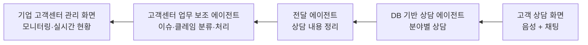
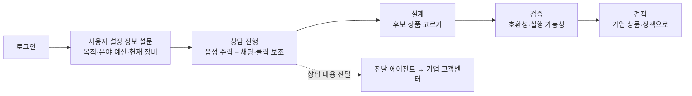

# BUILDWISE 기획서 수정안 — B2B 고객센터 자동화 (4·5·6장)

> 작성: 2026-11-18 · Claude Code · 상태: **초안 (팀 검토 전)**
> 근거: 기획서 변경 회의 피드백과 구조 그림(기업 관리 화면 ← 업무 보조 ← 전달 ← DB 기반 상담 ← 상담 화면)
> 장 번호는 피드백에 적힌 대로 썼습니다(4장 = 타깃 고객·상담 흐름, 5장 = 핵심 기능, 6장 = 상담 범위). 실제 반영본은 같은 폴더의 기획서 수정본 PDF입니다.
> `[팀 확인]` 표시는 팀이 정해야 채울 수 있는 칸입니다.

---

## 바뀌는 점 한눈에

| 구분 | 지금 | 수정 |
|---|---|---|
| 사업 모델 | B2B2C, 판매 기업의 AI 상담 직원 | **B2B 고객센터 자동화 플랫폼** — 기업에 상담부터 고객센터 관리까지 제공 |
| 타깃 고객 | 비전공자·학생·노트북 구매자·개발자·스타트업·연구실 | **고객센터를 운영하는 기업**. 위 사람들은 기업의 손님(최종 상담 이용자) |
| 상담 방식 | 텍스트 채팅 + 클릭식, 음성은 향후 확장 | **음성 상담 주력 + 채팅·클릭 보조**, 목표는 고객센터 상담원 대체 |
| 상담 흐름 | 바로 상담 시작 | 로그인 → 사용자 설정 정보 설문 → 상담 → 설계·검증·견적(이후 동일) |
| 상담 분야 | AI 개발 장비만 | **분야별 상담** (AI 개발 외 분야로 나눔) |
| 기업 쪽 기능 | 상품 DB·판매 정책 연결 | + **고객센터 관리 자동화, 모니터링(필수), 다중 사용자, 세일즈 영업 자동화** |
| 2D 부서 화면 | 고객에게 보여 주는 부서 | **기업 사용자용 부서** (기업 담당자가 보는 화면) |
| 클라우드 | 로컬 장비 vs 클라우드 GPU 비교 | **삭제** |

---

## 4장. 타깃 고객과 상담 흐름 (수정안)

### 4-1. 타깃 고객

BUILDWISE는 고객센터를 운영하는 기업에 AI 상담과 고객센터 관리 자동화를 함께 제공하는 **B2B 플랫폼**입니다. 플랫폼을 도입하는 쪽은 기업이고, 기업의 손님은 그 기업 고객센터에서 BUILDWISE 상담을 이용합니다.

| 구분 | 누구 | 쓰는 방식 |
|---|---|---|
| **도입 고객 (B2B)** | 노트북·PC·서버 등 IT 장비를 판매하고 고객센터를 운영하는 기업 | 자사 상품 DB와 판매 정책을 연결하고, 상담·고객센터 관리·영업을 자동화 |
| 기업 안의 사용자 | 고객센터 관리자, 상담원, 영업 담당자 | 관리 화면에서 실시간 현황·이슈·클레임을 확인하고, AI가 넘긴 상담 건을 처리 |
| 최종 상담 이용자 | 그 기업의 손님 | 음성·채팅으로 상담받고 추천·견적을 받음 |

> 기존 표의 "비전공자·학생·노트북 구매자·개발자·스타트업·연구실"은 타깃 고객이 아니라 **최종 상담 이용자의 예시**로만 씁니다. 필요하면 시연 시나리오의 손님 역할에 넣습니다.

### 4-2. 상담 흐름

1. **로그인** — 손님은 그 기업의 상담 창구로 들어옵니다. 기업별로 계정·데이터가 나뉩니다(다중 사용자).
2. **사용자 설정 정보 설문** — 상담 전에 목적, 분야, 예산, 지금 쓰는 장비 같은 기본 정보를 설문으로 받습니다. 설문 결과는 상담 에이전트가 처음부터 참고합니다.
3. **상담 진행** — 음성으로 상담하고, 화면에는 채팅 기록과 선택 항목(클릭식)이 함께 뜹니다. 음성이 어려운 환경에서는 채팅만으로도 진행합니다.
4. **이후 단계는 기존과 같음** — 설계 → 검증 → 견적. 조건이 바뀌면 다시 비교합니다.
5. **상담 내용 전달** — 상담이 끝나거나 사람이 처리할 일이 생기면, 전달 에이전트가 요약해 기업 고객센터로 넘깁니다.

---

## 5장. 핵심 기능 (수정안)

| 기능 | 내용 | 바뀐 정도 |
|---|---|---|
| A. 음성 중심 AI 상담 | 아래 참고 | **크게 바뀜** |
| B. 분야별 맞춤 진단 | 6장 참고 | **크게 바뀜** |
| C. Agentic Hardware Research | LangGraph 상담·검색·검증 워크플로, 공식 문서 RAG, 출처·확인 시점 표시 | 유지 |
| D. 호환성·실행 가능성 검증 | 규칙 기반 호환성 엔진 + RAG, 적합·부적합·추가 확인 필요 | 유지 |
| E. 업무 시각화·후속 자동화 | 에이전트 진행 과정 시각화, 비교 보고서·참고 견적서(PDF/HTML) | 유지 |
| F. 기업 연결 | 기업별 상품 DB·판매 정책 연결, 기업을 바꾸면 그 기업 상품으로 추천·견적 | 유지 (+ 다중 사용자) |
| **G. 기업 고객센터 관리 자동화** | 아래 참고 | **새로 추가** |
| **H. 세일즈 영업 자동화** | 아래 참고 | **새로 추가** |

### A. 음성 중심 AI 상담

- 고객센터 상담원 역할을 목표로 **음성 상담을 주력**으로 합니다. 음성 인식(STT)으로 듣고 음성 합성(TTS)으로 답합니다.
- 채팅과 선택 항목 클릭은 **보조 수단**입니다. 상담 중 화면에 대화 기록, 정리된 조건, 선택지를 함께 보여 줍니다.
- 로그인 뒤 사용자 설정 정보 설문으로 받은 내용을 상담 시작부터 반영합니다.
- 상담 중 조건이 바뀌면 감지해 추천을 다시 계산합니다(기존 유지).
- `[팀 확인]` 중간발표(11/26)에 음성까지 보여 줄지, 채팅으로 먼저 보여 주고 음성은 최종발표에 붙일지

### G. 기업 고객센터 관리 자동화 (새로 추가)

기업 담당자가 고객센터를 관리하는 과정도 자동화합니다.

- **전달 에이전트** — 상담 에이전트가 가져온 내용을 정리해 고객센터로 넘깁니다(손님 정보, 요청 요약, 추천·견적 결과, 사람이 확인할 점).
- **고객센터 업무 보조 에이전트** — 넘겨받은 내용을 이슈·클레임 등으로 분류하고 맞는 처리를 돕습니다.
- **모니터링 (필수)** — 고객 수요와 상담 실시간 현황을 관리 화면에 보여 줍니다.
- **자동 최신화** — 문서 최신화, 이슈 최신화, 오류 최신화, 클레임 공유, 고객 정보 업데이트.
- **다중 사용자** — 여러 기업과 각 기업의 관리자·상담원이 동시에 쓰고, 기업마다 데이터가 분리됩니다.
- **기업 사용자용 2D 부서 화면** — 상담·전달·업무 보조 에이전트가 일하는 모습을 기업 담당자가 2D 부서 형태로 봅니다.

### H. 세일즈 영업 자동화 (새로 추가)

- 상담 기록과 수요 현황을 영업에 연결합니다.
- `[팀 확인]` 구체 기능 범위 (예: 상담 뒤 후속 연락 대상 정리, 관심 상품별 잠재 고객 목록 등 — 회의에서 범위를 정해야 함)

---

## 6장. 상담 범위 (B항목 수정안)

### B. 분야별 맞춤 진단

AI 개발 장비만 상담하던 범위를 **분야별 상담**으로 나눕니다. 손님이 설문과 상담에서 고른 분야에 따라 필요한 사양 기준과 근거 자료가 달라집니다.

| 분야 | 상담 기준 예시 | 데이터 상태 |
|---|---|---|
| AI 개발 | 로컬 LLM 실행, 딥러닝 학습, 바이브코딩 | Blender·llmspeed 벤치마크 수집·정규화 완료 (11/17) |
| `[팀 확인]` 영상 편집 | 렌더링·인코딩 성능 | 공개 벤치마크 후보 조사 필요 |
| `[팀 확인]` 사진·디자인 | 이미지 처리 성능 | 후보 조사 필요 |
| `[팀 확인]` 음악 작업 | 오디오 처리·지연 | 후보 조사 필요 |
| `[팀 확인]` CAD·3D 설계 | 뷰포트·연산 성능 | 후보 조사 필요 |
| `[팀 확인]` 사무·학업 / 게임 | (넣을지 결정 필요) | - |

- 분야마다 같은 방식으로 진단합니다: 지금 장비 유지 → 업그레이드 → 신규 구매를 비교하고, 목적과 예산으로 적합성을 평가합니다.
- **클라우드 대안 비교는 뺍니다.** (기존 B항목의 "클라우드 대안 비교", 1-1장의 "로컬 장비 구매와 클라우드 GPU 비교" 문장 모두 삭제)

---

## 함께 고쳐야 하는 다른 곳

| 위치 | 고칠 내용 |
|---|---|
| 요약서·1장 프로젝트명 | "판매 기업의 상품 DB에 연결되는 AI 하드웨어 상담 직원" → "기업 고객센터를 자동화하는 AI 상담·관리 플랫폼" 쪽으로 `[팀 확인]` |
| 1-1 추진 배경 | 클라우드 비교 문장 삭제, "판매 기업은 상담 인력이 부족" → "기업 고객센터는 상담·이슈·클레임 처리에 인력이 많이 든다"로 확대 |
| 구현 범위 / 향후 확장 | "실시간 음성 상담"을 향후 확장에서 **구현 범위로** 옮김. 클라우드 관련 항목 삭제 |
| 역할표·WBS | 기업 관리 화면·모니터링, 전달·업무 보조 에이전트, 음성 담당을 역할에 넣어야 함 |
| DB 설계 (ERD) | 다중 사용자를 위해 기업(회사) 구분이 필요. 지금 8개 테이블(users·consultations·messages·parts·quotes·quote_items·part_compatibility·quote_validations)에는 기업 테이블과 이슈·클레임 테이블이 없음 `[팀 확인]` |
| 시연 시나리오 | 손님 상담 화면 + 기업 관리 화면을 함께 보여 주는 흐름으로 |

## 팀 회의에서 정할 것

1. 기업 관리 화면·모니터링 담당자
2. 음성 상담을 중간발표(11/26)에 넣을지
3. 분야를 몇 개로 나눌지, 어떤 분야를 넣을지
4. 세일즈 영업 자동화 범위
5. ERD에 기업·이슈·클레임 테이블을 추가할지
