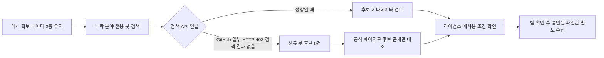

# 2026-11-17 누락 후보 재탐색 및 어제 결과 비교

## 실행 요약

| 항목 | 2026-11-16 기준 | 2026-11-17 재탐색 |
|---|---|---|
| 봇 검색 | 첫 실행 DNS 오류 24건 + Kaggle CLI 없음 12건. 재시도는 검색 오류 14건, 짧은 HF 검색에서 후보 11건 | 누락 항목 전용 7분야·16개 검색어를 GitHub·Hugging Face에서 조회. 후보 CSV 0건, GitHub API HTTP 403 6건, 나머지 26회 조회는 오류 없이 결과 0건 |
| 이미 확보한 데이터 | 게임 표본 20행, Blender 638,347행, 로컬 AI 220행 | 기존 원자료는 그대로 유지. 이번에는 신규 다운로드 없음 |
| 실행 산출물 | 어제 `candidates_hf_refined.csv`, `dataset_inventory.json` | `candidates_missing_20261117.csv`, `candidates_missing_20261117_errors.json`, `topics_missing_20261117.json` |

**해석:** 오늘 봇 실행은 누락 후보를 발견하지 못했다. 이번에는 DNS가 아니라 일부 GitHub API의 HTTP 403과 검색 결과 부재가 원인이었다. 결과 0건은 “해당 데이터가 없다”는 뜻이 아니다. 어제 후보 기록과 공식 사이트의 공개 정보를 별도로 대조해 아래에 상태를 갱신했다.

## 어제 대비 분야별 누락 상태

| 분야 | 어제 상태 | 재확인 결과 | 다음 처리 |
|---|---|---|---|
| 음악 제작 | DAWbench 테스트 세션 후보. 성능 결과 DB가 아니며 재사용 조건 미확인 | DAWbench 공식 사이트에 2026 DSP/VI 벤치마크가 보임. 실행용 세션 자료 후보라는 성격은 동일하며 공개 결과 표본 데이터셋인지는 확인되지 않음 ([공식 사이트](https://dawbench.com/)) | 세션 자료 이용 조건과 팀 평가 방식 확인. 현재 성능 점수 원자료로 취급하지 않음 |
| 영상 편집 | PugetBench Premiere 공개 비교 페이지. 재사용/내보내기 조건 미확인 | Puget 공식 페이지에서 공개 사용자 제출 결과를 버전 그룹별 비교하며, 최소 표본 기준 등 비교 조건을 안내 ([벤치마크 설명](https://www.pugetsystems.com/pugetbench/creators/premiere-pro/), [비교 페이지](https://www.pugetsystems.com/pugetbench/results/compare/Puget%20Bench%20for%20Premiere%20Pro/)) | 자동 수집 가능한 공개 API/내보내기 및 재사용 조건 확인 전 대량 수집 금지 |
| 사진 편집 | Lightroom/Photoshop 공개 비교 페이지. 재사용 조건 미확인 | Lightroom Classic과 Photoshop 모두 공개 결과 DB·버전별 비교 안내가 확인됨 ([Lightroom](https://www.pugetsystems.com/pugetbench/creators/lightroom-classic/), [Photoshop](https://www.pugetsystems.com/pugetbench/creators/photoshop/)) | 영상 분야와 동일하게 수집 권한·내보내기 조건 확인 |
| 게임 | Open GPU Benchmarks 표본 20건만 확보. Steam Machine 단일 시스템 합성 WebGL2 측정 | 기존 표본은 일반 게임/다양한 GPU 평가를 대표하지 못함. 오늘 봇은 추가 후보를 못 찾음 | 실제 게임별 GPU 결과 또는 공식 벤치마크 후보를 더 찾아 플랫폼/버전·해상도 조건 정규화 |
| 3D·CAD·게임 개발 | Blender Open Data 638,347건 확보. CAD 별도 자료 필요 | SPECviewperf 공식 결과 페이지가 존재하고, 공식 결과 준수·공정 사용 규칙이 별도 적용됨 ([결과 페이지](https://ftp.spec.org/gwpg/gpc.static/specviewperfresults.html), [공정 사용 규칙](https://www.spec.org/products/fairuse/)) | 결과를 그대로 재배포하기 전 라이선스/인용 규정 확인. Blender와 CAD 점수를 한 지표로 합치지 않음 |
| 로컬 AI·모델 개발 | HF `llm-speed-benchmarks` 220건 확보. MLPerf 공식 저장소는 후보이나 라이선스 미확인 | MLPerf Inference 공식 결과 저장소와 버전별 결과 저장소를 다시 확인 ([공식 결과 저장소](https://github.com/mlcommons/inference_results_v5.0), [벤치마크 설명](https://github.com/mlcommons/inference)) | 저장소/개별 결과 파일의 라이선스·사용조건 검토 후 선택된 파일만 수집 |
| RAG·부품 카탈로그 | `docyx/pc-part-dataset` 후보. 저장소 MIT, 원천 데이터 조건은 별도 확인 필요 | 후보 저장소에 CPU·GPU·보드 등 카탈로그 파일과 MIT 표기가 있으나, PCPartPicker에서 스크레이핑된 데이터의 원천 이용 조건과 2025-07-23 이후 최신성은 별도 리스크 ([저장소](https://github.com/docyx/pc-part-dataset)) | 우선 목록만 연결. 정진봉 님과 범위 확인 후 공식 제조사 사양·호환 문서의 문서명/URL 수집 |

## 흐름

## 확인 범위와 한계

- 봇은 후보 메타데이터 검색만 수행하며, 이번에 데이터 파일을 다운로드하지 않았다.
- 오늘 누락 전용 검색은 32회(16개 검색어 × 2개 플랫폼)였다. GitHub 6회는 HTTP 403으로 실패했고, 나머지 조회는 성공했지만 결과가 없었다. Kaggle은 어제와 같이 CLI가 없어 이번 탐색 대상에서 제외했다.
- 웹에서 확인한 결과는 공식 서비스의 공개 안내와 비교 페이지 존재 여부다. 페이지의 전체 원자료를 내려받거나 재배포 허가를 확인한 것은 아니다.
- SPECviewperf는 3D CAD/워크스테이션 그래픽에 적합한 후보지만, SPEC의 공정 사용/표시 규칙을 확인해야 한다.
- RAG는 평가용 성능 데이터와 목적이 다르다. 부품 카탈로그는 구조화 검색 후보이고, 공식 제조사 문서는 추천 근거 후보로 구분한다.

## 다음 단계

1. 진봉 님과 6개 분야에서 실행용 벤치마크 세션과 공개 성능 결과 중 무엇을 평가에 쓸지 합의한다.
2. Puget/SPEC/MLPerf 자료의 구체적 파일, 인용·재사용 조건을 확인한다.
3. DNS가 되는 실행 환경에서 같은 누락 전용 봇 검색을 다시 돌리거나, 공식 출처 링크를 수동 후보 목록으로 유지한다.
4. 확인 전에는 공개 결과를 대량 다운로드하거나 RAG 원자료로 적재하지 않는다.
