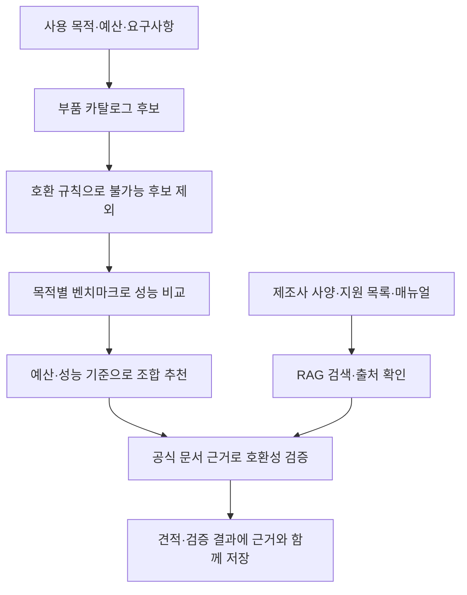
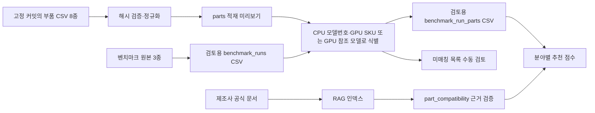

# ERD 기반 부품 추천·데이터 수집 계획 2차안

- 작성일: 2026-11-17
- 상태: **사용자 결정 반영 · 기존 ERD 8개 테이블 유지. 벤치마크 실제 저장 구조는 미확정**
- 검토 자료: 사용자 제공 `erd.png`, `docyx/pc-part-dataset`의 README/API 및 `data/` 구성, 2026-11-16에 확보한 성능 평가 파일 3종

## 1. 이해한 제품 흐름

사용 목적(게임·영상 편집·사진 편집·음악 제작·3D/CAD·로컬 AI)과 예산/조건을 입력받고, 부품 카탈로그에서 후보를 찾은 다음 공식 호환성을 확인하고 목적에 맞는 성능 자료로 후보를 정렬해 견적을 만드는 구조로 이해했다.

**큰 방향은 맞다.** 다만 카탈로그·호환성·벤치마크는 서로 다른 근거라 데이터와 검증을 분리해야 한다.



RAG가 부품을 직접 고르거나 호환 여부를 임의 판단하게 두기보다는, **구조화된 호환 규칙/검증 결과가 판정하고 RAG가 공식 문서의 해당 근거를 찾아 설명**하는 편이 ERD와 맞다. 공식 문서에서 읽은 조건은 검토·정규화해 `part_compatibility`의 `check_type`, `support_status`, `conditions`, `source_url` 등에 기록한다.

## 2. 확인된 입력 데이터

### 부품 카탈로그 후보

저장소 README는 PCPartPicker에서 수집한 부품 데이터 약 66,778개, 마지막 갱신일 2025-07-23, JSON·JSONL·CSV 형식을 안내한다. `data/`에는 각 형식별 파일이 따로 있고 CPU, CPU 쿨러, 메인보드, 메모리, 저장장치, 그래픽카드, 케이스, 파워 등 부품 종류별 파일이 있다. API 문서는 CPU 소켓, 메인보드 소켓/폼팩터/메모리 한도, 메모리 DDR·속도/모듈 구성, GPU 칩셋·메모리·길이, 케이스 규격, PSU 종류·와트수 등의 속성을 설명한다.

**1차 샘플 확인:** 고정 커밋 `c52a04ca9465c83997ed335f7767b09a2005dd26`의 `data/csv/`에서 CPU·쿨러·메인보드·메모리·저장장치·GPU·케이스·PSU 각 파일의 헤더와 앞 2개 행을 읽었다. 예를 들어 CPU는 `name, price, core_count, core_clock, boost_clock, microarchitecture, tdp, graphics`; 메인보드는 `name, price, socket, form_factor, max_memory, memory_slots, color`; GPU는 `name, price, chipset, memory, core_clock, boost_clock, color, length`다. API 문서의 설명과 같은 형태다.

샘플에는 별도 `brand`, `model_number`, 상품별 공식 `source_url`, 행별 갱신일이 보이지 않는다. 제품 식별은 대부분 `name` 문자열에 의존한다.

이후 고정 커밋에서 핵심 PC 조립 8개 CSV(총 2,705,941바이트)를 내려받고 Git blob SHA-1로 커밋 파일과 일치하는지 검증했다. 원본 45,951행 중 내용이 완전히 동일한 2,026행을 합치고, 동일 CPU 모델명·정적 사양의 별도 가격 레코드 219개도 한 `parts` 항목으로 묶어 현재 43,706개 행이다. 원본의 모든 행 번호와 가격 스냅샷은 crosswalk/specs에 연결했다. 일반 카테고리는 같은 이름에 여러 다른 사양의 제품이 있으므로 **상품명을 모든 부품의 고유 ID로 쓰면 안 된다.**

| 파일 | 원본 행 | 가격 비어 있음 | 주의 |
|---|---:|---:|---|
| `cpu.csv` | 1,413 | 866 | 이름 중복·가격 결측 |
| `cpu-cooler.csv` | 2,851 | 1,905 | 소켓 지원 필드 없음 |
| `motherboard.csv` | 4,973 | 4,022 | CPU 지원 BIOS/QVL 정보 없음 |
| `memory.csv` | 13,553 | 10,646 | 보드별 QVL 연결 없음 |
| `internal-hard-drive.csv` | 6,461 | 4,358 | 인터페이스 필드만으로 전체 보드 슬롯 호환 확정 불가 |
| `video-card.csv` | 6,636 | 5,361 | GPU 길이는 있지만 전원 커넥터 필드 없음 |
| `case.csv` | 6,626 | 5,573 | GPU 최대 길이·쿨러 간섭 치수 없음 |
| `power-supply.csv` | 3,438 | 2,871 | 와트수는 있지만 케이블 커넥터/실시간 가격 정보 없음 |

전체 가격 결측이 많고 행별 가격 확인 시점도 없으므로 원본 가격은 `current_price`에 넣지 않는다. 원본 가격은 `specs.source_price_snapshots`에 USD 참고값 배열로만 보존한다.

| 소스 파일 묶음 | `parts` 매핑 초안 | 주의 |
|---|---|---|
| `cpu`, `cpu-cooler`, `motherboard`, `memory` | `category`, `name`, 각 파일의 기술 속성을 `specs`로 매핑 | 원본에 `brand/model_number`가 없어 이름에서 자동 추출해 확정하지 않음. CPU-보드 지원은 소켓 문자열만 같다고 확정하지 말고 CPU 지원 목록/BIOS 조건 확인 |
| `video-card`, `case`, `power-supply` | GPU 칩셋·길이, 케이스 폼팩터/여유 길이, PSU 와트/규격 | 데이터에 없는 전원 커넥터·케이스 여유공간은 공식 사양으로 보강 |
| `internal-hard-drive` | 인터페이스, 용량, 폼팩터, SSD/HDD 종류 | M.2 외형과 NVMe/SATA 프로토콜을 구분하고 보드 슬롯 사양 확인 |
| `os`, 주변기기 등 | 이번 PC 본체 조립 MVP에서는 보류 후보 | 최종 시연 범위가 정해지면 포함 여부 결정 |

### 어제까지 확보한 성능 자료 1차 점검

| 분야·소스 | 실제로 가진 데이터 | 부품 추천에 바로 연결 가능한가 |
|---|---|---|
| 게임 · Open GPU Benchmarks | 20개 설정 조합. `steam_machine_8gb_valve`와 단일 Steam Machine 설정, WebGL2 합성 벤치마크 | **아니오.** 추천 대상 상용 GPU별 실측이 아니고 단일 장치 결과라 GPU 카탈로그 순위에 붙일 수 없음 |
| 3D 렌더링 · Blender Open Data | 638,347행. Blender 버전, 씬, CPU/GPU 장치명, 렌더 시간 등 | **부분 후보.** 장치명이 부품 모델명과 정확히 일치하는지 정규화/검수해야 하며, Blender 렌더링 이외 분야 성능을 뜻하지 않음 |
| 로컬 AI · llm-speed | 220행. 모델명, backend, workload, 가속기 요약 문자열, decode tokens/s | **부분 후보.** 여러 부품을 합친 자유형 `accelerator_summary`라 CPU/GPU별 귀속과 모델·양자화·소프트웨어 조건을 풀어야 함 |
| 영상·사진·음악·CAD | 현재 로컬 성능 원자료 없음 | 추천 순위 산출 근거로 쓰기 전에 별도 결과 자료 확보 또는 명시된 범위의 시연용 측정 필요 |

따라서 현재 수집물은 **벤치마크 소스의 1차 탐색/표본**이지 여섯 분야 PC 조합을 추천할 완성 데이터셋은 아니다. 이 값들을 `parts.specs`에 끼워 넣거나, 분야 태그만 붙여 성능 순위를 만드는 방식은 피한다. 측정은 PC 시스템 단위 결과일 수 있으므로, 특정 CPU/GPU 점수로 쪼개기 전에 시스템 구성과 해당 점수의 귀속 방식을 확인한다.

## 3. ERD 매핑과 발견된 구조 공백

### 기존 8개 테이블 매핑

| ERD 테이블 | 역할 | 데이터 흐름 |
|---|---|---|
| `parts` | 카탈로그 상품의 정규화 기준 | `category`, `name`, 사양만 매핑. 원본에 없는 `brand`와 `model_number`는 NULL. `source_url`은 제품별 URL이 아닌 고정 커밋의 CSV 파일 URL. `verified_at`은 제조사 문서를 대조하기 전까지 NULL. 기술 속성, 원본 행 식별 키, 출처 가격 스냅샷은 `specs` JSON에 기록 |
| `part_compatibility` | 부품 쌍 간 공식 호환 근거와 판정 | 공식 CPU 지원표, BIOS 지원표, 보드 메모리 지원/QVL, GPU 전력·길이, 케이스 여유, 쿨러 소켓/높이 등에서 규칙을 추출하고 출처와 확인일 기록 |
| `quote_items` | 추천된 견적 시점의 부품/가격 스냅샷 | 현재 상품 정보가 나중에 바뀌어도 견적 당시 부품명·수량·단가·구성을 보존 |
| `quote_validations` | 견적 조합의 호환 검증 결과와 근거 스냅샷 | 어떤 `quote_version`의 어느 항목 쌍을 어떤 규칙으로 검사했는지와 근거를 연결 |

데이터 원본의 가격은 저장소 설명상 USD이며 공개 스냅샷 최종 갱신도 2025-07-23이다. 이를 한국 실시간 판매가로 간주하면 안 된다. 가격은 `current_price`에 바로 현재값으로 넣기보다, 시연에 쓸 가격 출처/통화/갱신 시각을 별도로 정한 뒤 넣고, 견적에서는 `quote_items` 가격 스냅샷을 쓴다.

### 벤치마크 데이터와 현재 ERD의 경계

사용자는 제공한 ERD의 기존 8개 테이블을 유지하기로 했다. 현재 그림에는 벤치마크 실행 결과와 한 번의 측정에 포함된 구성 부품을 보관할 전용 테이블이 없다. 그러므로 `benchmark_runs`와 `benchmark_run_parts`는 이번 ERD에 추가된 테이블이 아니다. 수집 봇이 만드는 같은 이름의 CSV는 분석·검토용 파일 형식이며, 확정된 DB 테이블이나 실제 ERD를 뜻하지 않는다.

벤치마크 결과를 동적으로 변하는 측정값이라는 이유로 `parts.specs` JSON에 억지로 넣지 않는다. CSV 파일은 출처, workload, 점수, 시스템 스냅샷과 측정 부품 후보를 보존한다. DB 저장이 필요해지면 기존 8개 테이블의 용도와 충돌하지 않는 저장 위치·관계가 있는지 DB 담당자와 먼저 검토하고, 8개 테이블 유지 결정으로 해결할 수 없는 경우에만 ERD 변경안을 별도 제안한다. 현재 DB 적재는 보류한다.

수집 CSV의 필드는 이런 정보를 분리해 둔다.

| 검토용 CSV | 보존하는 정보 | 현재 상태 |
|---|---|---|
| `benchmark_runs_preview.csv` | 측정 분야, benchmark/version, workload, 점수, 시스템 구성, 출처·라이선스 | 검토용 전체 run 파일 |
| `benchmark_run_parts_preview.csv` | 측정 run ID, 부품 ID, 구성품 역할, 매칭 상태와 근거 | 부품 연결 검토 파일 |
| `benchmark_runs_load_ready.csv` | 검증된 부품 연결이 있는 run만 포함 | 후속 DB 설계 협의 후보 |

벤치마크는 시스템 전체 결과일 수 있다. **전체 시스템 점수를 개별 CPU/GPU 점수로 자동 귀속하지 않는다.** 동일 workload 조건에서 특정 부품에 귀속된 점수인지 확인한 뒤 추천에 사용한다.
가격은 저장소 설명상 USD이며 전체 파일에서 대부분 비어 있다. 남은 가격 값도 시점 정보가 없고 데이터셋 갱신일은 2025-07-23이므로 한국 현재가로 사용하지 않는다. 원본 가격을 보존할 경우 `parts.specs.source_price_snapshots`에 배열로 넣고 `current_price`/`currency`는 최신 판매처 자료가 확보되기 전까지 NULL로 둔다.

## 4. 수집 계획 재구성

1. **고정 데이터셋 가져오기:** 확인된 커밋 SHA에서 핵심 부품 CSV 8개를 가져왔고, 저장소 스크레이퍼로 PCPartPicker를 다시 조회하지 않았다.
2. **파일 검증·프로파일링:** Git blob SHA-1을 검증하고 카테고리별 행 수, 필드 누락, 정확 중복, 상품명 중복, 가격 결측을 계산했다. 이름만으로 브랜드/모델번호를 확정하지 않는다.
3. **원본·정규화본 분리:** 원본 파일과 SHA-256·출처·커밋을 보존한다. 완전히 동일한 행은 `parts` 미리보기에서 합치고, 각 원본 행 번호는 crosswalk에 남긴다. 이름만 같은 서로 다른 행은 별개로 보존하고 수동 확인 대상으로 표시한다.
4. **`parts` 적재 후보:** 확인 불가 `brand/model_number`는 NULL, `source_url`은 파일 출처 URL, `verified_at`은 제조사 자료 검증 전 NULL. 오래된 USD 가격은 `current_price`로 표시하지 않는다.
5. **공식 호환성 근거 수집:** 제조사 페이지/매뉴얼/지원 CPU·메모리 목록을 대상으로 모델별 URL, 문서 개정일, 수집일, 쪽/절, 추출된 규칙과 사람이 확인한 상태를 저장한다. RAG 원문 인덱스와 `part_compatibility` 구조화 판정은 같은 출처 ID/URL로 연결하되 역할은 구분한다.
6. **벤치마크 결과 정규화:** 기존 게임/Blender/llm-speed 자료를 검토용 `benchmark_runs_preview.csv`로 정규화하고 구성품 후보를 `benchmark_run_parts_preview.csv`로 연결한다. 이 이름은 CSV 산출물 이름일 뿐 실제 ERD 테이블이 아니다. 정확한 모델과 부품 역할·시스템 구성이 확인된 경우에만 매칭하고, 그 외는 `unmatched/review`로 남겨 추천 점수에서 제외한다.
7. **목적별 추천 점수:** 우선 `parts`에서 호환/예산 후보를 필터링하고, 해당 목적(workload)의 비교 가능한 벤치마크만 사용해 정렬한다. 벤치마크가 부족한 부품은 점수를 꾸며내지 않고 “데이터 부족”으로 표기한다.
8. **시연용 검증:** 게임/영상/사진/음악/3D·CAD/로컬 AI 각각 하나 이상의 실제 workload와 입력 조건을 정하고, 추천 결과·호환 판정·근거 링크를 수동 표본으로 검토한 뒤 수집 범위를 늘린다.

## 5. 남은 확인 사항

사용자는 현재 8개 테이블 ERD를 유지하기로 했다. 벤치마크 CSV의 구조는 DB 테이블 확정안이 아니다. 성능 원자료를 저장할 위치와 관계가 현재 8개 테이블에서 성립하는지 팀 DB 설계 담당자와 확인한다. 별도 테이블이 꼭 필요하다고 결론 나면 사용자 확인 후 ERD 수정안을 별도로 작성한다.

실제 DB 적재와 호환성 공식 문서 수집은 별도 단계다. 저장소 루트의 MIT 라이선스 표기와 스크레이핑된 제3자 상품 데이터의 이용·재배포 권한은 계속 별도 확인이 필요하다.

## 6. 수집 봇 연결 결과 (2026-11-17)

봇을 검색만 하는 도구에서 **부품 원본 → `parts` 미리보기 → 벤치마크 행 → 부품 매칭 검토 → 추천 입력**까지 이어지는 로컬 데이터 파이프라인으로 확장했다. 다만 현재는 CSV 미리보기 단계이며 DB 적재나 추천 점수 계산은 하지 않는다.



### 구현 내용과 CLI

1. 완료: `dataset_crawler.py import-parts`로 고정 커밋 부품 CSV 8종을 검증하고 `parts` 미리보기·source crosswalk를 만든다. 동일 CPU 모델명과 정적 사양이 반복된 219개 레코드는 한 제품 ID로 통합하고 원본 행 연결은 보존한다.
2. 완료: `prepare-benchmarks`로 Open GPU Benchmarks YAML, Blender CSV, llm-speed CSV를 검토용 `benchmark_runs_preview.csv` 형식으로 변환한다. 출처별 기본 1,000행, `--all` 전체 처리다.
3. 완료: CPU는 실행환경 접미사를 제외한 정확 모델번호로 연결한다. GPU는 원본에서 판매 SKU가 식별되면 해당 SKU에 연결하고, 칩 모델까지만 식별되면 `parts_with_benchmark_references_preview.csv`에 참조 모델을 추가해 연결한다. 참조 모델은 `reference_only=true`, `quote_eligible=false`, `purchase_eligible=false`로 표시해 견적·구매 추천에서 제외한다.
4. 미구현: 추천기는 목적/작업(workload)과 비교 조건이 맞는 측정만 점수에 사용해야 한다. 전체 시스템 점수와 특정 부품 점수를 혼동하지 않는다.
5. 미착수: 제조사 공식 호환 문서는 제조사 URL·문서 개정/확인일·모델·페이지를 기록하고, 구조화된 확인 결과를 `part_compatibility`와 RAG 출처에 연결한다.

전체 재처리 결과: PC 부품 원본 45,951행에서 43,706개 `parts` 후보를 만들고, 벤치마크에서 모델명이 식별된 GPU 참조 행 249개를 더한 `parts_with_benchmark_references_preview.csv`는 43,955행이다. 총 638,587개 run 중 **498,704개**에 부품 연결이 있어 `benchmark_runs_load_ready.csv`로 분리했다. 연결 레코드는 498,704건이며 CPU 모델번호 196,558건과 GPU 참조 모델 302,146건이다. GPU 참조 행은 249개이고 현재 산출물에서 판매 GPU SKU 직접 연결은 확인되지 않았다. 139,883개 run은 부품 연결이 없어 보류했다. `run_id` 집합·`part_id` FK·중복 연결·구매/견적 제외 플래그를 검증했다. 전체 run 파일은 검토용이다. 현재 ERD 8개 테이블에는 벤치마크 전용 run/link 테이블이 표시되어 있지 않으므로 DB 저장 방식은 담당자와 확정 전까지 실제 적재하지 않는다.

## 7. 진봉 님의 RAG 범위와 성욱 님의 성능 데이터 방향

진봉 님의 2026-11-16 Google Sheet는 제품 간 호환성·BIOS·장착 제약, OEM 노트북 및 Mac/eGPU 모델 조건과 CUDA·ROCm·OpenVINO·DirectML·WSL·llama.cpp·Transformers·PyTorch 실행 조건을 공식 문서로 확인하는 RAG 계획이다. Notion 일일보고도 “제품 호환성 위주의 데이터 수집”을 기록하고, DB/RAG 수집을 진행 중인 일로 둔다. 이는 벤치마크 점수 데이터와 목적이 달라 두 계획은 보완 관계다.

성욱 님의 계획은 PC 부품 카탈로그에 게임·영상·사진·음악·3D/CAD·로컬 AI 성능 측정 데이터를 연결해 사용 목적별 추천을 평가하는 쪽이다. 현재 `docyx/pc-part-dataset`은 2025-07-23 기준의 데스크톱 부품 중심이라 진봉 님의 OEM 노트북·Mac·런타임 플랫폼을 모두 표현하지 못한다. 따라서 팀 카탈로그 범위에 노트북 완제품·Mac/SoC·eGPU·소프트웨어 런타임을 넣을지 별도로 합의해야 한다. 출처 대조와 상세 비교는 `진봉님_자료와_성욱님_데이터수집방향_비교_2026-11-17.md`에 기록했다.

예정 사용 예시는 다음과 같다.

```powershell
python .\dataset_crawler.py import-parts --download
python .\dataset_crawler.py prepare-benchmarks --limit 1000
python .\dataset_crawler.py prepare-benchmarks --all
```

`benchmark_runs_preview.csv`에는 출처·라이선스·벤치마크/앱 버전·workload·측정값/단위·시스템 스냅샷을 보존한다. 검토용 `benchmark_run_parts_preview.csv`에는 실제로 식별된 구성품만 연결하며, 나머지는 별도의 미매칭 검토표로 남긴다. 이 파일들은 현 ERD의 실제 테이블이 아니다. DB 스키마 입력·마이그레이션과 공식 문서 수집은 팀 DB 담당자와 필드 합의 후 진행한다.

## 출처

- [저장소 README](https://github.com/docyx/pc-part-dataset) — 데이터 설명, 형식, 갱신일, 저장소 라이선스 표기
- [API.md](https://github.com/docyx/pc-part-dataset/blob/main/API.md) — 부품별 필드/단위 설명
- [`data/` 디렉터리](https://github.com/docyx/pc-part-dataset/tree/main/data) — CSV/JSON/JSONL 및 압축 파일
- [고정 커밋 CPU CSV](https://github.com/docyx/pc-part-dataset/blob/c52a04ca9465c83997ed335f7767b09a2005dd26/data/csv/cpu.csv) 및 같은 `data/csv/`의 나머지 7개 원본
- 기존 수집 데이터: [수집 인벤토리](../../../../../data/collection/runs/2026-11-17/dataset_inventory.json). 원본 Blender·llm-speed·Open GPU Benchmarks 파일은 저장소에 복제하지 않고 위 안내의 원본 링크를 사용한다.
- 가져오기 변환기/산출물: [부품 가져오기 봇](../../../../../scripts/collection/import_pc_parts.py), [부품 정규화 미리보기가 포함된 전체 데이터 ZIP](../../../../../data/benchmarks/releases/2026-11-17/2026-11-17_공유데이터_일괄다운로드.zip)
