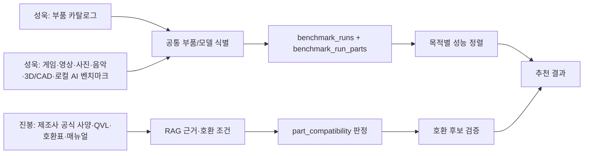

# 진봉 님 자료와 성욱 님 데이터 수집 방향 비교

작성일: 2026-11-17 · 비교 대상: 진봉 님의 2026-11-16 RAG 수집 시트·Notion 일일보고, 성욱 님의 PC 부품·성능평가 데이터 계획 및 이번 재매칭 결과

## 한눈에 보기

두 방향은 서로 충돌하지 않고 역할이 다르다. 진봉 님 자료는 **공식 문서에서 호환·지원·실행 조건을 찾아 판정 근거로 쓰는 RAG**가 중심이다. 성욱 님 계획은 **사용 목적별 성능 측정값을 부품과 연결해 추천 후보를 평가하는 데이터**가 중심이다. 같은 제품 모델·부품 식별자가 양쪽을 잇는 기준이 되어야 한다.

## 자료에서 확인한 범위

| 비교 항목 | 진봉 님 자료 | 성욱 님 계획·현재 수집 |
|---|---|---|
| 목적 | 제품↔제품 호환, BIOS·장착 예외, 지원 OS·런타임 조건을 공식 근거로 확인 | PC 부품 데이터를 정규화하고 6개 사용 분야별 성능 후보를 모아 목적별 추천에 활용 |
| 입력 데이터 | 제조사 사양·매뉴얼, CPU 지원표·메모리 QVL·OEM Parts Lookup, CUDA/ROCm/OpenVINO/DirectML/WSL·llama.cpp/Transformers/PyTorch 문서 | `docyx/pc-part-dataset`의 부품 CSV 8종과 공개 벤치마크 자료 |
| 대상 범위 | 데스크톱 부품 외에 Framework·Dell/Alienware·HP·Lenovo·ASUS 노트북, Mac/macOS·eGPU·외장 디스플레이, NPU와 OS별 실행 플랫폼 | 기존 `pc-part-dataset`은 데스크톱 조립 부품 중심. 현재 성능 파일은 Open GPU Benchmarks·Blender Open Data·llm-speed |
| 결과 형태 | 모델·문서·페이지·버전을 붙인 RAG 청크와 구조화된 호환 예외/판정 | 측정값·workload·시스템 스냅샷을 가진 `benchmark_runs`; 식별된 부품 FK는 `benchmark_run_parts` |
| 현재 상태 | 시트에 수집 개요·크롤링 원문·RAG 근거·RAG 청크·출처 문서·브랜드 수집범위가 있음. Notion 일일보고는 제품 호환성 중심 수집을 기록하고 RAG 수집을 진행 중 업무로 표시 | 부품 카탈로그와 벤치마크 변환기 실행 완료. 실제 DB 적재는 아직 안 함 |

진봉 님 시트의 수집 개요는 완제품/노트북 모델↔RAM·SSD, CPU↔메인보드·칩셋, 보드↔메모리 QVL, Mac 모델↔macOS/eGPU/외장 디스플레이를 다룬다. 같은 소켓·칩셋만으로 호환을 단정하지 않고, QVL·최소 BIOS·온보드/외장 여부·슬롯 조건을 확인하도록 경계를 둔다. 문서 근거 목록에는 Framework, Intel, AMD, ASUS, Apple, NVIDIA, Microsoft, PyTorch 및 모델별 OEM 지원 페이지가 포함되어 있다.

Notion의 2026-11-16 일일보고에는 “제품 호환성 위주의 데이터 수집” 링크와 프로젝트 검증 워크플로 초안 완료가 기록되어 있다. 이 문서에는 6개 성능평가 분야의 수집 계획이나 벤치마크 행/부품 매칭 기준은 명시되어 있지 않다.

## 재매칭 결과와 적재 경계

- CPU는 Blender 장비명에서 `8-Core Processor`, 세대 설명, 동작속도 같은 실행환경 문자열을 제외하고 제조사·제품군·정확 모델번호·접미사를 비교했다. 예를 들어 `AMD Ryzen 7 7800X3D 8-Core Processor`는 `AMD Ryzen 7 7800X3D`에 연결한다.
- PC 부품 CSV의 동일 CPU명·동일 정적 사양 중복 219개 레코드는 한 `parts` ID로 통합했다. 원본 CSV 행과 가격 스냅샷은 crosswalk/specs에 보존했다. 서로 다른 정적 사양은 임의로 합치지 않는다.
- GPU는 측정명이 `RTX 3070` 같은 칩셋까지만 가리키면 판매 SKU를 임의로 선택하지 않는다. 사용자 승인에 따라 모델을 식별할 수 있는 GPU는 `parts_with_benchmark_references_preview.csv`에 참조 전용 행으로 추가했다. `specs.record_kind=benchmark_reference_model`, `reference_only=true`, `quote_eligible=false`, `purchase_eligible=false`로 표시해 견적·구매 대상에서 제외한다. 원문에 제조사 SKU가 명확할 때만 실판매 SKU에 연결한다.
- Blender 전체 638,347행과 다른 두 자료를 합친 638,587개 run 중 498,704개가 `benchmark_runs_load_ready.csv`에 담겼다. GPU 참조 행 249개를 추가했고 연결 레코드는 CPU 모델번호 196,558건과 GPU 참조 모델 302,146건이다. 현재 산출물에서는 판매 GPU SKU 직접 연결을 확인하지 못했다. 나머지 139,883개 run은 부품 연결이 없어 적재 후보에서 제외했다. `run_id` 집합, `part_id` FK, 중복 연결과 참조행의 구매·견적 제외 플래그를 검증했다.
- 여섯 성능 분야 중 현재 연결된 자료는 Blender 3D 렌더링과 llm-speed 로컬 AI의 일부다. 게임 20개는 Steam Machine 전체 측정이라 특정 parts 행에 연결하지 않았고, 영상 편집·사진 편집·음악 제작 자료는 아직 없어 추가 수집이 필요하다.

따라서 현재 `benchmark_runs_preview.csv` 전체본은 변환/검토용이다. 적재 검토에는 `benchmark_runs_load_ready.csv`, `benchmark_run_parts_preview.csv`, 참조 GPU 모델이 포함된 `parts_with_benchmark_references_preview.csv`가 한 묶음으로 필요하다. 현재 ERD는 사용자가 유지하기로 한 8개 테이블이며 벤치마크 전용 run/link 구조가 표시되어 있지 않다. DB 담당자와 저장 위치·필드·PK/FK를 확정하기 전에는 DB에 넣지 않는다.

## 같이 맞춰야 할 범위

성욱 님의 PC 카탈로그는 2025-07-23 기준 데스크톱 부품 중심이고, 진봉 님의 공식 문서 범위는 OEM 노트북·Mac/SoC·eGPU·NPU·소프트웨어 런타임까지 넓다. 이 범위를 제품 추천에 모두 포함할 계획이면 `parts` 카탈로그에 해당 제품군도 들어와야 한다. `pc-part-dataset` 단독으로는 그 목록을 표현할 수 없다.

GPU 칩 모델 단위 측정은 판매 SKU와 구별되는 참조 행으로 기록하기로 했다. 이 행은 GPU 모델 성능 비교에만 쓰며, 실제 판매 부품 추천·호환 판정·견적 계산에는 사용하지 않는다. 적재 검토 시에는 참조 행을 포함한 parts 파일과 벤치마크 run/link 파일을 함께 사용한다.

### 비교 결론과 진봉 님과 맞출 항목

- 두 데이터는 경쟁 관계가 아니라 역할이 다르다. 성능 자료는 “이 모델이 특정 workload에서 어느 정도 수행했는가”를 설명하고, 공식 문서 RAG는 “이 조합이 지원되며 어떤 조건·예외가 있는가”를 설명한다.
- 공통 연결키는 부품의 제조사·모델명·모델번호가 되어야 한다. 측정 이름이 판매 제품을 특정하지 못하면 참조 모델로 묶고, 판매 SKU나 호환을 추정하지 않는다.
- 진봉 님과 우선 맞출 것은 (1) 6개 사용 분야 명칭과 workload 경계, (2) 데스크톱 부품 외 노트북·Mac/eGPU/NPU를 MVP에 넣을지, (3) 공식 RAG 근거에서 모델·문서버전·조건·출처 URL을 어떤 형식으로 유지할지, (4) 현재 8개 테이블에서 벤치마크 원자료를 어디에 저장할지다.
- 현재 성능 수집은 3D 렌더링과 로컬 AI 일부만 해당한다. 게임 원자료는 전체 시스템 측정이라 연결하지 않았고, 영상·사진·음악은 새 출처가 필요하다. 따라서 이 결과를 6개 분야 추천 성능을 모두 검증한 것으로 해석하면 안 된다.

## 확인한 원문

- [진봉 님 Google Sheet — BUILDWISE_RAG_공식근거_수집_20261116](https://docs.google.com/spreadsheets/d/1WKg-FClGu48Cnh2eKi-pz3B6VPPGXYZCCbK-u2zOeI8/edit?gid=2126076731#gid=2126076731) — 수집 개요, RAG 근거·청크, 출처 문서, 브랜드 수집범위 탭을 읽음.
- [진봉 님 Notion — 26.11.16 일일보고](https://quilled-step-4b8.notion.site/26-11-16_-41a3ed157176806bb7ece556d187cc0a) — 제품 호환성 데이터 수집 및 프로젝트 작업 흐름 진행 상태를 읽음.
- 성욱 님의 수집 계획/코드/실행 결과: 같은 폴더의 `ERD_기반_부품추천_수집계획_2차안.md`, [봇 안내](../../../../../scripts/collection/README.md), [벤치마크 변환 manifest가 포함된 데이터 ZIP](../../../../../data/benchmarks/releases/2026-11-17/2026-11-17_공유데이터_일괄다운로드.zip).

외부 문서와 시트는 읽기만 했으며 수정하지 않았다.
