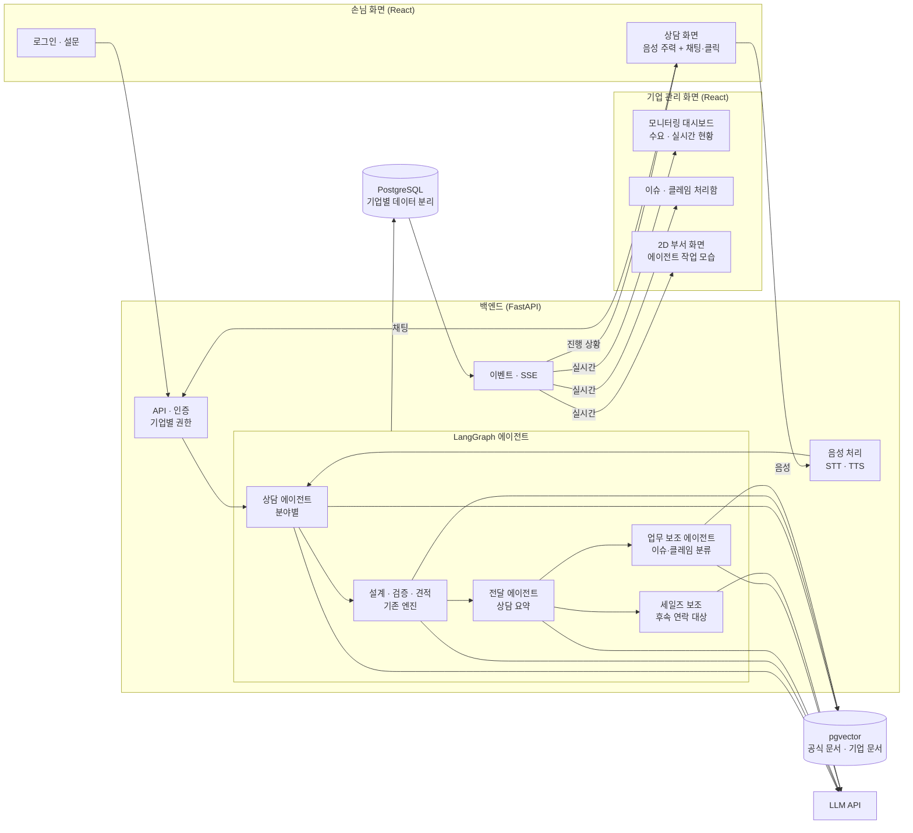
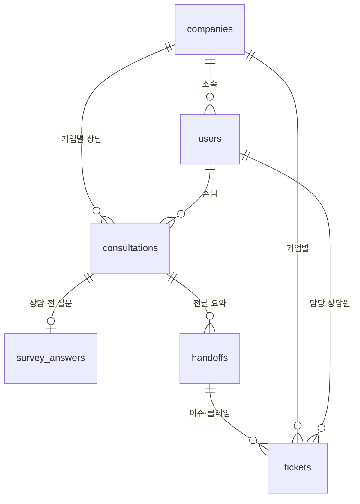
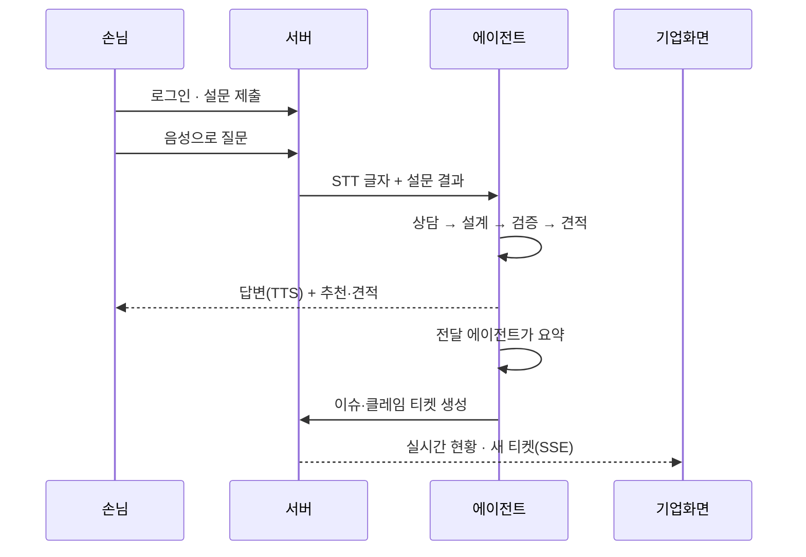

# BUILDWISE 아키텍처 설계 (간략) — B2B 고객센터 자동화

> 작성: 2026-11-18 · Claude Code · 상태: **초안 (팀 검토 전)**
> 근거: 기획서 수정안(B2B 고객센터 자동화), 기존 팀 구조 문서(`ARCHITECTURE.md`: React + FastAPI 단일 프로세스 + DB + SSE), 기획서 3-2의 인프라(PostgreSQL + pgvector 단일 DB)
> `[팀 확인]`은 팀이 정해야 하는 칸입니다.

## 1. 한 줄 요약

기존 상담 엔진(상담→설계→검증→견적)은 그대로 두고, 앞에 **음성 입력**, 뒤에 **전달·업무 보조 에이전트와 기업 관리 화면**을 붙이며, 모든 데이터에 **기업 구분(company_id)** 을 넣어 여러 기업이 함께 쓰게 합니다.

## 2. 전체 구조

## 3. 구성 요소

| 층 | 구성 | 하는 일 | 기존 대비 |
|---|---|---|---|
| 화면 | 손님 화면 | 로그인 → 설정 정보 설문 → 음성·채팅 상담 → 추천·견적 확인 | 로그인·설문·음성 추가 |
| 화면 | 기업 관리 화면 | 모니터링(필수), 이슈·클레임 처리함, 2D 부서 화면, 상품·정책 관리 | **새로 추가** |
| 서버 | API · 인증 | 손님/기업 사용자 로그인, 역할(관리자·상담원·영업), 모든 요청에 `company_id` 확인 | 기업 헤더 → 인증 기반으로 |
| 서버 | 음성 처리 | 음성 → 글자(STT), 답변 → 음성(TTS). 엔진은 `[팀 확인]` | **새로 추가** |
| 에이전트 | 상담 에이전트 | 설문 결과를 받아 분야별로 질문하고 조건 정리 | 분야별로 확장 |
| 에이전트 | 설계·검증·견적 | 후보 고르기 → 호환성·실행 가능성 검증 → 기업 정책으로 견적 | 그대로 |
| 에이전트 | 전달 에이전트 | 상담 끝/사람 필요 시 요약(손님 정보·요청·결과·확인할 점)을 고객센터로 | **새로 추가** |
| 에이전트 | 업무 보조 에이전트 | 이슈·클레임·오류로 분류, 처리 제안, 문서·이슈 최신화 | **새로 추가** |
| 에이전트 | 세일즈 보조 | 관심 상품별 잠재 고객, 후속 연락 대상 정리 (범위 `[팀 확인]`) | **새로 추가** |
| 서버 | 이벤트 · SSE | 에이전트 진행 상황을 손님 화면과 기업 화면에 실시간 전송 | 받는 화면이 기업 쪽까지 |
| 데이터 | PostgreSQL | 기업·사용자·상담·견적·이슈·클레임, 상품·벤치마크 | 기업·이슈 테이블 추가 |
| 데이터 | pgvector (같은 PostgreSQL 안) | 공식 문서·기업 문서 RAG | 기업 문서 추가 |

## 4. 데이터 (ERD 추가분만)

지금 8개 테이블(users·consultations·messages·parts·quotes·quote_items·part_compatibility·quote_validations)에 아래를 더하는 안입니다.

| 새 테이블 | 핵심 칸 |
|---|---|
| `companies` | 기업명, 판매 정책, 취급 분야 |
| `survey_answers` | 목적, 분야, 예산, 현재 장비 |
| `handoffs` | 상담 요약, 추천·견적 결과, 사람이 확인할 점 |
| `tickets` | 종류(이슈·클레임·오류), 상태, 담당자, 처리 기록 |

- `users`에 `company_id`, `role`(손님·관리자·상담원·영업) 추가.
- 기업별 데이터 분리는 **모든 조회에 `company_id` 조건**으로 합니다(한 DB 공유).

## 5. 주요 흐름

## 6. 설계 원칙

1. **기존 엔진은 건드리지 않고 앞뒤로 붙입니다.** 설계·검증·견적 계약(API·이벤트)은 유지합니다.
2. **서버가 상태의 기준**입니다. 화면은 이벤트를 받아 그릴 뿐입니다(기존 원칙 유지).
3. **음성은 입출력만 바꿉니다.** 음성이 안 되면 채팅으로 같은 흐름이 돌아가야 합니다.
4. **8주 MVP는 서버 1개**로 갑니다. 여러 서버로 늘리는 작업 큐(Redis 등)는 범위 밖입니다.

## 7. 팀에서 정할 것

1. STT·TTS 엔진 (예: Whisper 같은 오픈소스 / 브라우저 음성 API / 유료 API — 유료면 비용 확인)
2. 지금 팀 SQL 파일(`parts_catalog.sql`)은 MySQL 문법이라 PostgreSQL로 옮기는 시점
3. 로그인 방식 (손님은 간단 로그인, 기업 사용자는 계정+역할)
4. 기업 관리 화면을 손님 화면과 같은 React 앱에 둘지, 따로 둘지
5. 세일즈 보조를 MVP에 넣을지
