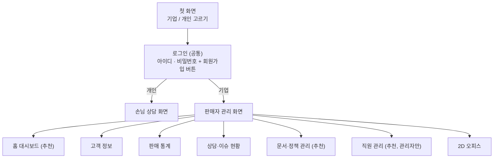

# 판매자 고객센터 관리 화면 — 정리

> 작성: 2026-11-18 · Claude Code · 사용자 메모 정리 + 사용자 결정 5개 반영 (팀 검토 전)
> **(추천)** 표시는 메모에 없던 것을 Claude가 덧붙인 항목입니다.

## 0. 한눈에

## 결정 사항 (2026-11-18)

| # | 질문 | 결정 |
|---|---|---|
| 1 | 기업 인증번호 발급 | **임의 발급** — 기업마다 미리 정한 번호를 DB에 넣어 둠(시연용 고정값) |
| 2 | 관리자·상담원 역할 구분 | **MVP에 포함** — 고객센터 자동화가 전체 틀이므로 둘 다 필요 |
| 3 | 악성 사용자 감지 | **욕설만 자동 감지**, 블랙컨슈머는 관리자가 직접 차단 |
| 4 | 재고 | **재고 수량 관리는 하지 않음** — 판매 통계로 잘 팔리는 상품만 파악 |
| 5 | 상담·이슈 현황 | **별도 메뉴**, 2D 오피스와 분리 |

## 1. 첫 화면 · 로그인 · 회원가입

| 구분 | 로그인 | 회원가입 |
|---|---|---|
| 개인 (손님) | 아이디 + 비밀번호 | 아이디 + 비밀번호 |
| 기업 (판매자) | 아이디 + 비밀번호 | 아이디 + 비밀번호 + **기업 인증번호** |

- 기업 인증번호는 기업마다 미리 정해 둔 번호입니다(임의 발급). 이 번호로 어느 회사 소속인지 연결하고(`company_id`), 같은 회사 고객 데이터만 봅니다.
- 역할은 **관리자 · 상담원** 두 가지입니다. 시연에서는 관리자 계정을 미리 만들어 두고, 상담원은 가입 후 관리자가 승인하거나 역할을 정합니다(아래 직원 관리).

| 메뉴 | 관리자 | 상담원 |
|---|---|---|
| 홈 · 고객 정보 조회 · 상담·이슈 현황 · 2D 오피스 | O | O |
| 악성 사용자 차단 / 해제 | O | 차단 요청만 |
| 판매 통계 · 문서·정책 관리 · 직원 관리 | O | X |

## 2. 판매자 화면 메뉴

### 2-0. (추천) 홈 대시보드

로그인하면 처음 보는 요약 화면입니다.

- 오늘 상담 수, 미처리 이슈 · 클레임 수
- 잘 팔리는 부품 TOP 5
- 욕설 감지 알림

### 2-1. 고객 정보

| 하위 메뉴 | 내용 |
|---|---|
| **고객별 조회** | 고객 유형, 고객 ID, 견적서, 상담 이력을 고객 한 명 단위로 봄. 검색 · 필터(추천) |
| **악성 사용자 관리** | **욕설은 자동 감지**해 표시 → 관리자가 차단. 블랙컨슈머는 관리자가 직접 차단 / 해제. 차단 사유 · 처리자 기록(추천) |

- (추천) 고객 이력에 **상담 요약 카드**를 붙입니다(전달 에이전트가 만든 요약: 요청 · 추천 결과 · 확인할 점).

### 2-2. 판매 통계

- 고객별이 아니라 **항목별 · 부품별** 판매 수치를 그래프로 봅니다.
- 재고 수량은 다루지 않고, **잘 팔리는 상품을 파악**하는 데 씁니다.
- (추천) 기간별 추이(일 · 주 · 월), **상담에서 많이 물어본 부품 vs 실제 판매** 비교, 견적 → 구매 전환율

### 2-3. 상담 · 이슈 현황 (별도 메뉴)

- 실시간 상담 수, 대기 건, 처리 완료 건 (모니터링 필수)
- **이슈 · 클레임 처리함**: 업무 보조 에이전트가 분류한 건을 보고, 상담원이 확인 · 완료 처리
- (추천) **상담원 인계**: AI가 처리하기 어려운 건을 상담원이 넘겨받아 이어서 처리

### 2-4. (추천) 문서 · 정책 관리 — 관리자만

회의 피드백의 "문서 최신화"에 해당합니다.

- 공지 · FAQ · AS 정책 문서를 올리면 상담 에이전트가 참고(RAG)
- 판매 정책(배송비 · 할인) 수정 → 견적에 바로 반영

### 2-5. (추천) 직원 관리 — 관리자만

역할 구분이 MVP에 들어가므로 필요합니다.

- 상담원 계정 승인 · 역할 변경 · 비활성화

### 2-6. 2D 오피스

- **목적:** 에이전트가 일하는 모습을 보는 화면. 미니 오피스처럼 꾸미고, 사용자는 최고 관리자 시점으로 내려다봅니다.

| 자리 | 에이전트 | 화면에 보이는 모습 |
|---|---|---|
| 상담 창구 | 상담 에이전트 | 손님과 상담 중인 건 수 |
| 전달 데스크 | 전달 에이전트 | 상담 요약을 서류로 만들어 넘김 |
| 업무 보조 부서 | 고객센터 업무 보조 에이전트 | 전달받은 건을 이슈 · 클레임에 맞게 분류 · 처리 |

- (추천) 에이전트나 서류를 누르면 그 건의 상태(받음 → 분류 → 처리 중 → 완료)가 뜹니다.
- 움직임은 서버 이벤트(SSE)를 받아 그립니다.
- 2D 오피스는 **보는 용도**입니다. 실제 처리는 고객 정보 · 상담·이슈 현황 메뉴에서 합니다.

## 3. 추가 기능 우선순위 (추천)

| 순위 | 기능 | 이유 |
|---|---|---|
| MVP | 홈 대시보드 | 이미 만드는 데이터(상담 · 이슈 · 판매)를 모아 보여 주기만 하면 돼서 쉽고, 시연 첫 화면으로 좋음 |
| MVP | 직원 관리 | 역할 구분을 MVP에 넣었으므로 필요 |
| MVP | 문서 · 정책 관리 | 회의 피드백 "문서 최신화"에 직접 대응, RAG와 연결 |
| 시간 되면 | 상담원 인계 | 고객센터 자동화의 "사람에게 넘김"을 보여 줌 |
| 시간 되면 | 상담 만족도(상담 후 별점) | 상담 품질을 숫자로 보여 줌 |
