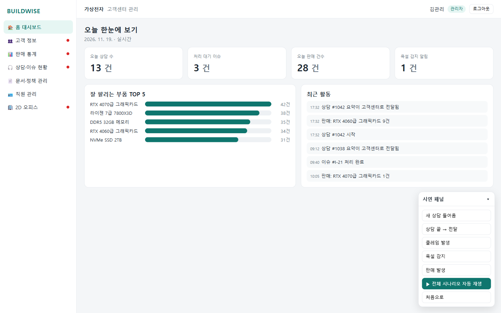
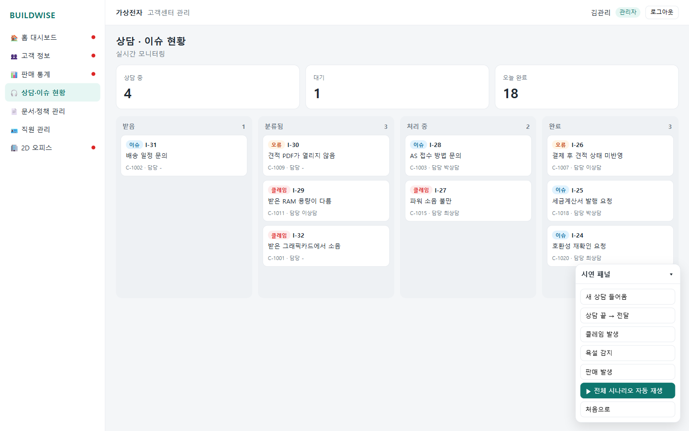
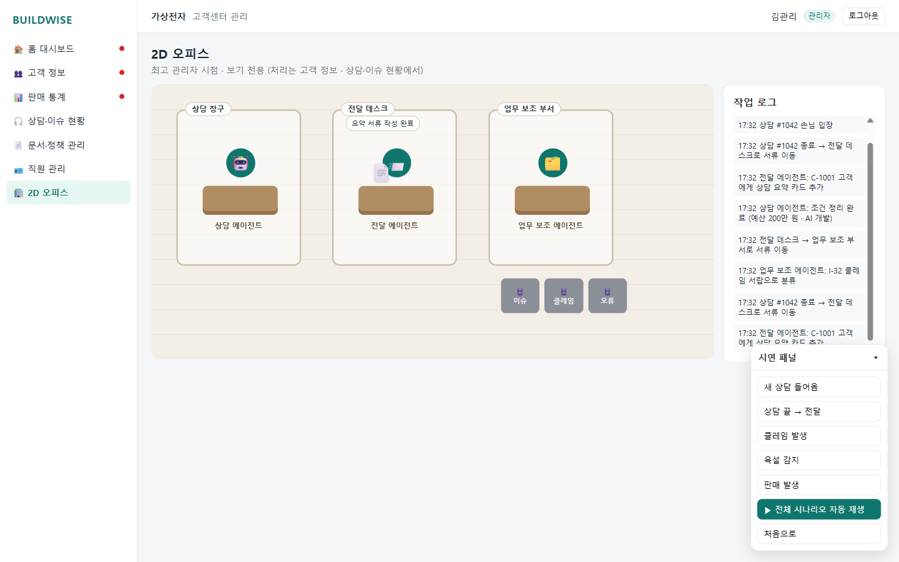
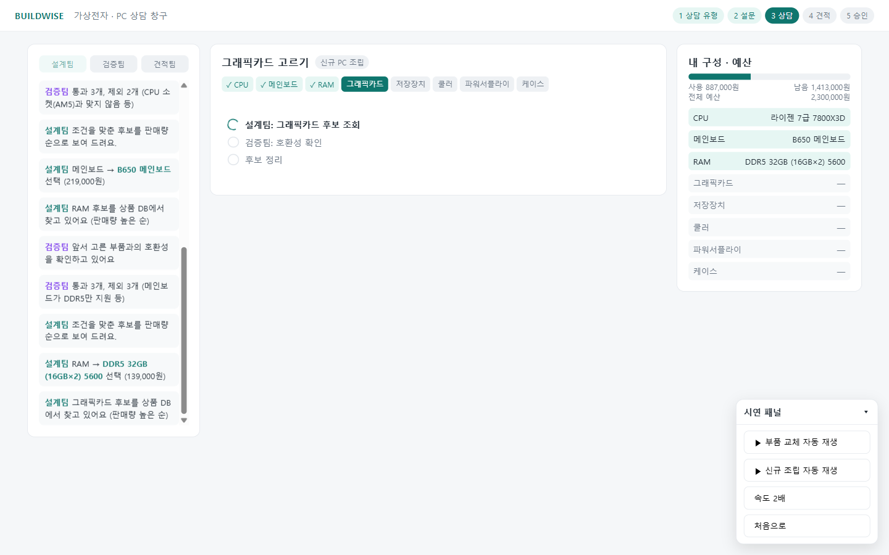
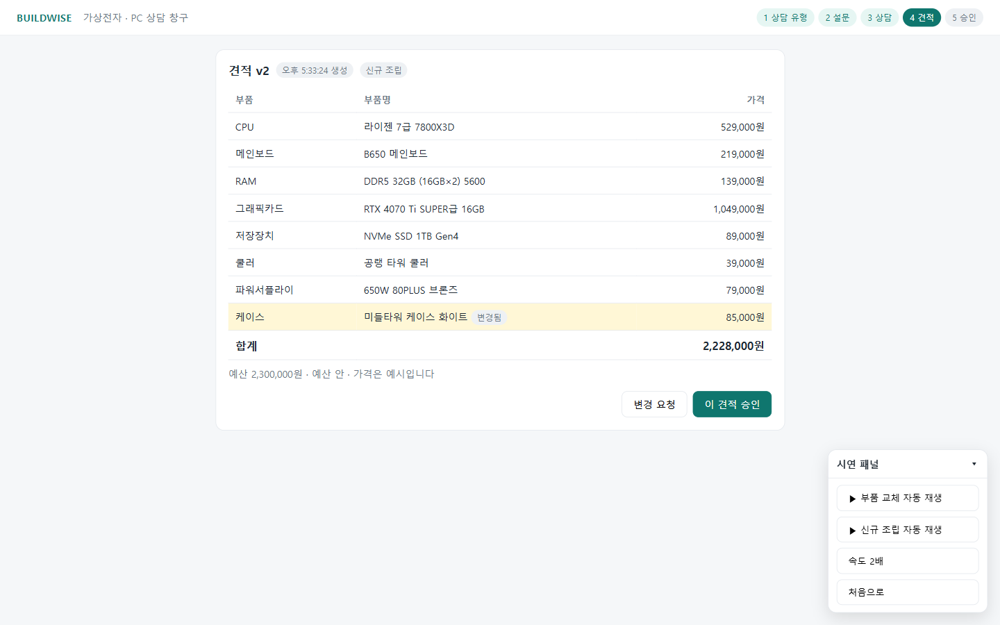

# 목업 (클릭하면 움직이는 시연용 화면)

서버·인터넷 없이 HTML 파일 하나로 도는 가짜 화면입니다. 데이터는 모두 예시이고, 업무팀(AI)의 동작은 타이머로 흉내만 냅니다.

## 미리 보기

| 판매자 — 홈 대시보드 | 판매자 — 상담·이슈 칸반 | 판매자 — 2D 오피스 |
|---|---|---|
|  |  |  |

| PC 상담 — 상담 화면 | PC 상담 — 견적 v2 (바뀐 줄 강조) |
|---|---|
|  |  |

## 여는 방법

GitHub에서 HTML 파일을 누르면 코드가 보입니다. 파일을 **내려받아 브라우저로 열면** 화면이 나옵니다. 노트북 화면(1440×900) 기준입니다.

| 파일 | 화면 | 만든 기준 |
|---|---|---|
| [판매자관리화면_목업.html](판매자관리화면_목업.html) | 판매자(어드민) 관리 화면 | [판매자 관리 화면 정리](../../11월18일/설계/판매자_관리화면_정리.md) · [목업 프롬프트](../../11월18일/설계/판매자화면_목업_프롬프트.md) |
| [PC상담화면_목업.html](PC상담화면_목업.html) | 손님 PC 상담 화면 | [PC 상담 목업 프롬프트](../설계/PC상담화면_목업_프롬프트.md) |

## 판매자 관리 화면

- 첫 화면에서 **기업** → **관리자로 시연** 또는 **상담원으로 시연**을 누릅니다. 상담원은 판매 통계·문서·직원 관리 메뉴가 잠깁니다.
- 회원가입의 기업 인증번호 예시: `BW-1001`, `BW-2002`
- 오른쪽 아래 **시연 패널** 버튼: 새 상담 들어옴 · 상담 끝 → 전달 · 클레임 발생 · 욕설 감지 · 판매 발생 · 전체 시나리오 자동 재생 · 처음으로
- 버튼을 누르면 홈 숫자, 고객 정보, 상담·이슈 칸반, 판매 통계, 2D 오피스(서류 이동)에 함께 반영됩니다.

## PC 상담 화면

- 흐름: 상담 유형 → 설문 → 상담(업무팀 로그 · 후보 카드 · 내 구성·예산) → 견적 → 승인
- 오른쪽 아래 **시연 패널**: 부품 교체 자동 재생 · 신규 조립 자동 재생 · 속도 2배 · 처음으로
- 부품 교체: 가격 낮은 순, 가장 저렴한 후보에 "AI 추천" 표시 → 승인 뒤 결제 화면(가짜)
- 신규 조립: CPU → 메인보드 → RAM → GPU → 저장장치 → 쿨러 → 파워 → 케이스, 판매량 순 · 앞 부품과 호환되는 후보만 → "예산 더 쓰기"와 조정 제안 → 견적 변경 요청 시 v2 견적

## 주의

- 실제 서버·결제·로그인 코드는 없습니다. 상품명·가격·기업·사람 이름은 모두 예시입니다.
