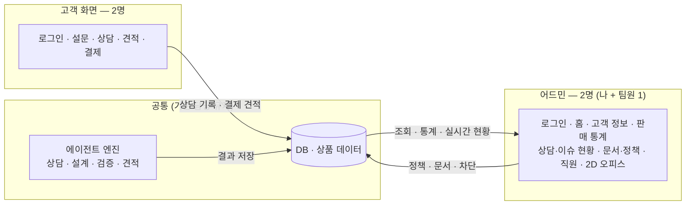
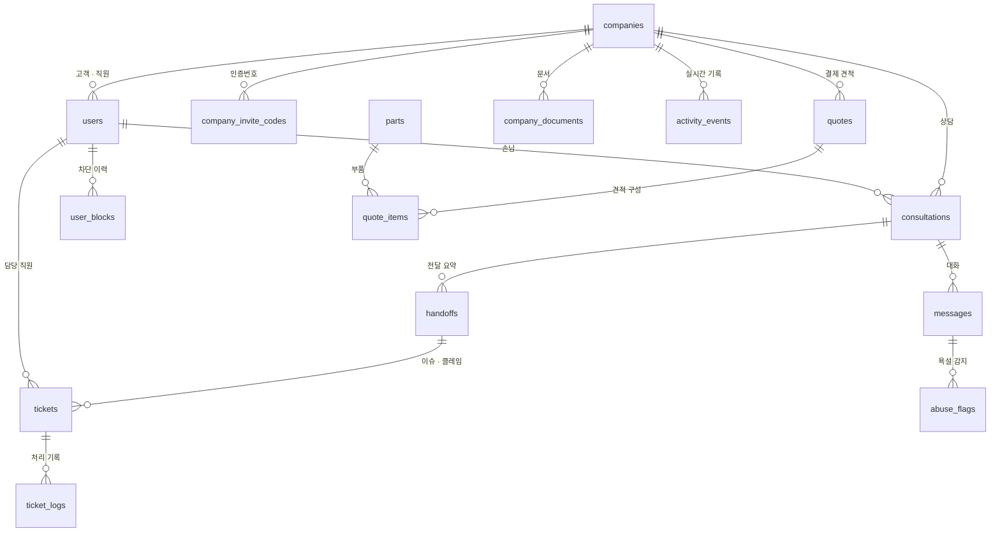
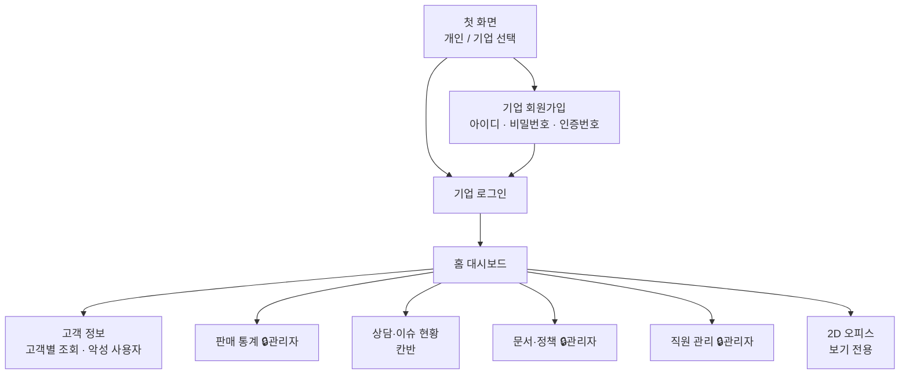

# BUILDWISE 어드민(판매자 관리 화면) 기초 설계

> 작성: 2026-11-19 · SKN35shimsungwook · 상태: **초안 (폴더·코드 변경 없음)**
> 기준: 팀 저장소 `dev` 최신 커밋 `4b34b66`(2026-11-19), 판매자 관리 화면 정리(11-18), 판매자 관리 화면 목업(11-18), 아키텍처 간략 설계(11-18)
> 이 문서는 **시초 설계**입니다. 지금 폴더 구조나 코드를 바꾸지 않고, "어드민을 만들면 무엇이 생기고 무엇이 바뀌는지"를 미리 정리합니다.
> `[추후 결정]`은 구현하면서 정해 나갈 칸입니다(13장).

---

## 1. 역할 분담



- 고객 화면이 **데이터를 만드는 쪽**, 어드민은 **그 데이터를 읽고 관리하는 쪽**입니다.
- 그래서 어드민의 핵심 선행 조건은 "고객 화면·에이전트가 **어떤 데이터를 어떤 모양으로** 남기느냐"입니다(6장 계약).

---

## 2. 지금 dev에 있는 것 (건드리지 않음)

dev 안에는 **두 층**이 섞여 있습니다.

| 층 | 무엇 | 상태 | 어드민과의 관계 |
|---|---|---|---|
| ① 예전 Mock 앱 | `api/routes.py`(세션·이벤트·견적·주문 API), `companies/`, `events/service.py`(SSE), 프론트 `App.tsx`(오피스·상담·후보·견적 한 화면) | 문서(`ARCHITECTURE.md`)가 스스로 "기존 Mock 앱의 기록"이라고 밝힘. `main.py`·`routes.py`가 부르는 `app/core/db.py`가 dev 파일 목록에 없음 → **지금 그대로 실행되지 않을 가능성** (실행해서 확인하지는 않음) | **설계 아이디어만 참고** — 기업 정책 형식(`CompanyPolicy`), SSE 순번 규칙, `X-Company-Id` |
| ② 새 실제 DB | MySQL `dev_database`, `mysql-connector`, 테이블 8개 (`users`·`consultations`·`messages`·`parts`·`quotes`·`quote_items`·`part_compatibility`·`quote_validations`), `db/paid_quotes.py`(결제 견적 저장) | **현재 기준.** 11-19까지 칼럼 정리 중 | **어드민 데이터의 출발점** |

### 새 실제 DB에서 어드민이 바로 쓸 수 있는 것

| 테이블 | 지금 칼럼(요약) | 어드민에서 쓰는 곳 |
|---|---|---|
| `users` | user_id, display_name, created_at | 고객 정보 목록 |
| `consultations` | user_id, purpose, requirements(JSON) | 상담 이력, 수요 통계(목적별) |
| `messages` | consultation_id, role, content | 상담 대화 보기, **욕설 감지 대상** |
| `quotes` | user_id, consultation_type(UPGRADE/NEW_BUILD), payment_reference, paid_at, total_amount | 고객별 견적서, **판매 통계(결제 견적만 들어 있음)** |
| `quote_items` | quote_id, part_id, part_name_snapshot, quantity, unit_price | 판매 TOP10, 분야별 비중 |
| `parts` | category, brand, name, current_price, image_url | 상품 이름·분류 |

### 없는 것 (어드민 때문에 새로 필요)

기업 구분, 로그인·역할, 기업 인증번호, 전달 요약(handoff), 이슈·클레임 티켓, 욕설 감지·차단 기록, 기업 문서·정책, 실시간 활동 기록(대시보드·2D 오피스용).

---

## 3. 무엇이 바뀌나 — 변경 영향 한눈에

| 영역 | 바뀌는 것 | 기존 파일에 미치는 영향 | 누가 |
|---|---|---|---|
| DB | 새 테이블 8개 + 기존 3개에 칼럼 추가 (4장) | `users`·`consultations`·`quotes`에 `company_id` 추가 → **고객 화면·결제 저장 코드도 이 값을 넣어야 함** | 어드민 + DB 담당 합의 |
| DB 문법 | MySQL 그대로 vs PostgreSQL 이전 | 기획서는 PostgreSQL+pgvector, dev는 MySQL. 이전 PR이 열려 있음 → 새 테이블 SQL을 어느 문법으로 쓸지 | `[추후 결정]` |
| 백엔드 | 어드민 API 묶음 `/api/admin/...` 새로 추가 (7장) | 기존 파일 수정 없음, **새 폴더만 추가** | 어드민 |
| 인증 | 로그인·역할 검사 | 지금은 인증이 전혀 없음 → 고객 로그인과 **같은 방식**을 써야 함 | 고객 화면 담당과 합의 |
| 에이전트 | 전달 에이전트·업무 보조 에이전트 결과 저장 | 기존 상담→설계→검증→견적 엔진은 그대로, **끝에 붙임** | `[추후 결정]` 누가 만드는지 |
| 실시간 | 기업 단위 SSE 스트림 (8장) | 예전 SSE는 세션 단위. 어드민은 **기업 전체** 이벤트 필요 | 어드민 |
| 프론트 | 어드민 화면 묶음 + 화면 이동(라우터) | 지금 `App.tsx`는 한 화면짜리 → 고객/어드민 **입구 분리** 필요. 라우터 패키지 추가 필요 | `[추후 결정]` |
| 문서 | `docs/admin/` 설계·API 문서 | 기존 문서 수정 없음 | 어드민 |

---

## 4. 데이터 설계 (초안)

### 4-1. 기존 테이블에 더하는 칼럼

| 테이블 | 추가 칼럼 | 이유 |
|---|---|---|
| `users` | `company_id`, `login_id`(유니크), `password_hash`, `user_type`(CUSTOMER/STAFF), `role`(ADMIN/AGENT, 직원만), `status`(ACTIVE/BLOCKED) | 기업별 고객·직원 구분, 로그인, 차단 |
| `consultations` | `company_id`, `status`(진행 중/완료/인계), `ended_at` | 기업별 상담 현황, 실시간 건수 |
| `quotes` | `company_id` | 기업별 판매 통계 |

> 고객과 직원을 `users` 한 테이블에 둘지, 직원을 `staff_users`로 분리할지 `[추후 결정]`. 이 초안은 **한 테이블 + user_type** 안입니다(로그인 화면 하나로 처리 가능).

### 4-2. 새 테이블

| 테이블 | 핵심 칼럼 | 쓰는 메뉴 |
|---|---|---|
| `companies` | company_id, name, slug, policy(JSON: 취급 분야·배송비·할인·견적 유효기간), created_at | 전체(기업 구분), 문서·정책 |
| `company_invite_codes` | code(유니크), company_id, role(ADMIN/AGENT), used_by, used_at, expires_at | 회원가입(기업 인증번호) |
| `handoffs` | handoff_id, company_id, consultation_id, summary, customer_request, result_snapshot(JSON), check_points, created_by_agent, created_at | 상담·이슈, 2D 오피스(서류) |
| `tickets` | ticket_id, company_id, handoff_id, user_id(고객), type(ISSUE/CLAIM/ERROR), status(NEW/CLASSIFIED/IN_PROGRESS/DONE), priority, assignee_id(직원), suggestion(에이전트 처리 제안), created_at, closed_at | 상담·이슈 칸반, 홈 |
| `ticket_logs` | log_id, ticket_id, actor_type(AGENT/STAFF), actor_id, action, memo, created_at | 이슈 처리 기록 |
| `abuse_flags` | flag_id, company_id, user_id, message_id, kind(PROFANITY/MANUAL), matched_text(가림 처리), status(OPEN/BLOCKED/DISMISSED), reviewed_by, created_at | 악성 사용자 관리 |
| `user_blocks` | block_id, company_id, user_id, reason, blocked_by, blocked_at, unblocked_by, unblocked_at | 차단·해제 이력 |
| `company_documents` | doc_id, company_id, title, kind(MANUAL/POLICY/FAQ), file_path, version, status(UPLOADED/INDEXED/FAILED), uploaded_by, updated_at | 문서·정책 (RAG 연결) |
| `activity_events` | event_id, company_id, seq(기업 안 순번), type, actor(에이전트/직원), ref_kind, ref_id, message, occurred_at | 홈 실시간, 2D 오피스, SSE |

### 4-3. 관계도



### 4-4. 메뉴별 데이터 출처

| 메뉴 | 읽는 테이블 | 쓰는 테이블 |
|---|---|---|
| 홈 대시보드 | consultations, tickets, quotes, activity_events | — |
| 고객 정보 | users, consultations, messages, quotes, quote_items | — |
| 악성 사용자 | abuse_flags, user_blocks, messages | abuse_flags(검토), user_blocks, users.status |
| 판매 통계 | quotes, quote_items, parts, consultations(수요) | — |
| 상담·이슈 현황 | handoffs, tickets, ticket_logs | tickets(담당·상태), ticket_logs |
| 문서·정책 | company_documents, companies.policy | 둘 다 |
| 직원 관리 | users(STAFF), company_invite_codes | 둘 다 |
| 2D 오피스 | activity_events, consultations, handoffs, tickets | — (보기만) |

> 판매 통계의 "수요"는 **결제 안 된 견적이 DB에 없어서**(quotes = 결제 견적만) 상담의 `purpose`·`requirements`로 셉니다. 견적 단계 이탈률까지 보려면 미결제 견적 기록이 필요 → `[추후 결정]`.

---

## 5. UI 구성

### 5-1. 화면 지도



### 5-2. 공통 틀

| 자리 | 내용 |
|---|---|
| 왼쪽 사이드바 | 메뉴 7개, 권한 없는 메뉴는 🔒, 새 건 있으면 빨간 점 |
| 위쪽 바 | 기업 이름, 로그인한 직원·역할, 실시간 연결 상태, 로그아웃 |
| 본문 | 메뉴별 화면 |
| 알림 | 새 이슈·욕설 감지 시 오른쪽 위 토스트 |

### 5-3. 메뉴별 화면 구성

| 메뉴 | 화면 구성 | 주요 동작 |
|---|---|---|
| **홈** | 숫자 카드 4개(오늘 상담 · 처리 대기 이슈 · 오늘 판매 · 욕설 감지), 실시간 활동 목록, 최근 전달 요약 카드 | 카드 누르면 해당 메뉴로 |
| **고객 정보 — 고객별 조회** | 검색·필터 + 고객 표(고객 ID · 유형 · 상담 수 · 결제 견적 수 · 상태) + 오른쪽 상세 패널(상담 이력 · 견적서) | 견적서 보기(모달) |
| **고객 정보 — 악성 사용자** | 욕설 감지 목록(문장 가림 처리) + 차단 목록 | 관리자: 차단·해제 / 상담원: 차단 요청 |
| **판매 통계** | 일·주·월 전환, 판매 TOP10, 분야별 비중(도넛), 매출 추이(선), 수요 vs 판매 비교, 상담→결제 전환율 | 기간 바꾸기 |
| **상담·이슈 현황** | 4칸 칸반(새로 들어옴 → 분류됨 → 처리 중 → 완료), 카드 = 유형 배지 · 고객 · 요약 · 담당자 | 카드 열기 → 전달 요약 · 에이전트 제안 · 처리 기록, 담당자 지정, 상태 변경 |
| **문서·정책** | 문서 목록(종류 · 버전 · 반영 상태) + 올리기, 판매 정책 폼(배송비 · 할인 · 견적 유효기간 · 취급 분야) | 올리기 → "반영 중 → 반영됨" |
| **직원 관리** | 직원 표(역할 · 상태), 인증번호 발급 목록 | 역할 변경, 비활성화, 인증번호 만들기 |
| **2D 오피스** | 방 3개(상담 창구 · 전달 데스크 · 업무 보조 부서), 에이전트 캐릭터, 서류 이동, 서랍(이슈·클레임), 아래 활동 로그 | 보기만 (누르면 해당 건 상세) |

### 5-4. 권한표

| 기능 | 관리자 | 상담원 |
|---|---|---|
| 홈 · 고객 조회 · 상담·이슈 · 2D 오피스 | O | O |
| 이슈 담당 지정 · 상태 변경 | O | 자기 담당만 |
| 악성 사용자 차단·해제 | O | 차단 요청만 |
| 판매 통계 · 문서·정책 · 직원 관리 | O | X (메뉴 🔒, API도 403) |

> 권한은 **화면에서 숨기기 + API에서 막기** 둘 다 합니다. 화면만 숨기면 주소를 직접 쳐서 들어갈 수 있습니다.

---

## 6. 고객 화면·에이전트와 맞출 약속 (선행 조건)

어드민은 남이 만든 데이터를 보여 주는 화면이라, 아래가 정해지지 않으면 가짜 데이터로만 돌아갑니다.

| # | 약속 | 상대 | 없으면 |
|---|---|---|---|
| 1 | 고객 가입·로그인 때 `company_id`를 함께 저장 | 고객 화면 | 기업별 고객 구분 불가 |
| 2 | 상담 시작·끝에 `consultations.status` 갱신 + `activity_events` 기록 | 고객 화면 / 백엔드 | 홈·2D 오피스 실시간 숫자 불가 |
| 3 | 손님 메시지를 `messages`에 저장(욕설 검사 대상) | 고객 화면 / 상담 에이전트 | 욕설 감지 불가 |
| 4 | 결제 완료 때 `quotes`에 `company_id` 포함 저장 | 결제 흐름 담당 | 기업별 판매 통계 불가 |
| 5 | 상담 끝/사람 필요 시 전달 에이전트가 `handoffs` 저장 | 에이전트 담당 `[추후 결정]` | 이슈 칸반이 비어 있음 |
| 6 | 업무 보조 에이전트가 `tickets.type`·`suggestion` 채움 | 에이전트 담당 `[추후 결정]` | 분류 자동화 시연 불가 |
| 7 | 로그인 방식(세션 쿠키 vs 토큰) 하나로 통일 | 고객 화면 + 어드민 | 로그인 두 번 구현 |
| 8 | 차단된 고객(`users.status=BLOCKED`)은 상담 시작 막기 | 고객 화면 | 차단이 시늉만 됨 |

---

## 7. API 초안 (`/api/admin/...`)

모든 요청은 로그인한 직원의 `company_id`로 자동 제한합니다(다른 기업 데이터는 404).

| 메서드 | 경로 | 하는 일 | 권한 |
|---|---|---|---|
| POST | `/api/auth/signup/staff` | 아이디·비밀번호·인증번호로 직원 가입 | 누구나 |
| POST | `/api/auth/login` · `/logout` · GET `/api/auth/me` | 로그인·로그아웃·내 정보 | 누구나 / 로그인 |
| GET | `/api/admin/dashboard` | 숫자 카드 4개 + 최근 전달 요약 | 직원 |
| GET | `/api/admin/customers?q=&status=` | 고객 목록 | 직원 |
| GET | `/api/admin/customers/{id}` | 고객 상세(상담·견적) | 직원 |
| GET | `/api/admin/abuse-flags` | 욕설 감지 목록 | 직원 |
| POST | `/api/admin/customers/{id}/block` · `/unblock` | 차단·해제 | 관리자 |
| POST | `/api/admin/customers/{id}/block-request` | 차단 요청 | 상담원 |
| GET | `/api/admin/stats/sales?period=day\|week\|month` | 매출·TOP10·분야 비중·전환율 | 관리자 |
| GET | `/api/admin/tickets?status=` · GET `/{id}` | 칸반 목록·상세 | 직원 |
| PATCH | `/api/admin/tickets/{id}` | 담당자·상태 변경(+처리 기록) | 직원(권한표) |
| GET·POST | `/api/admin/documents` | 문서 목록·올리기 | 관리자 |
| GET·PUT | `/api/admin/policy` | 판매 정책 보기·바꾸기 | 관리자 |
| GET | `/api/admin/staff` · PATCH `/{id}` | 직원 목록·역할 변경 | 관리자 |
| POST | `/api/admin/invite-codes` | 인증번호 만들기 | 관리자 |
| GET | `/api/admin/events/stream?after=` | 기업 단위 실시간 이벤트(SSE) | 직원 |

---

## 8. 실시간 이벤트 (기업 단위 SSE)

예전 Mock 앱의 규칙(순번 빈틈없이, 받은 번호 다음부터만)을 그대로 쓰되 **세션 단위 → 기업 단위**로 바꿉니다.

| type | 언제 | 화면 반영 |
|---|---|---|
| `consultation.started` · `consultation.ended` | 상담 시작·끝 | 홈 숫자, 2D 오피스 상담 창구 |
| `handoff.created` | 전달 요약 생성 | 2D 오피스 서류 이동, 홈 최근 요약 |
| `ticket.created` · `ticket.classified` · `ticket.updated` | 티켓 생성·분류·변경 | 칸반 카드, 사이드바 빨간 점 |
| `abuse.flagged` | 욕설 감지 | 토스트, 홈 숫자 |
| `quote.paid` | 결제 견적 저장 | 홈 오늘 판매, 통계 |
| `customer.blocked` | 차단·해제 | 고객 표 상태 |

> 목업의 시연 버튼 7개(상담·전달·클레임·욕설·판매 …)가 이 이벤트들과 1:1로 대응합니다. 그래서 **목업 → 실제 연결 때 화면 코드를 거의 그대로** 쓸 수 있습니다.

---

## 9. 폴더 구조 안 (지금 바꾸지 않음 — 제안만)

```text
backend/app/
  admin/                  ← 새로 추가 (어드민 전용)
    routes.py             /api/admin/* 엔드포인트
    auth.py               로그인 · 역할 검사 (고객 쪽과 공용이면 app/auth/로)
    customers.py          고객 조회 · 차단
    stats.py              판매 통계 집계
    tickets.py            이슈 · 클레임
    documents.py          문서 · 정책
    staff.py              직원 · 인증번호
    events.py             기업 단위 SSE
  db/sql/migrations/
    012_companies_and_auth.sql      ← 번호는 그때 마지막 번호 다음
    013_handoffs_tickets.sql
    014_abuse_and_blocks.sql
    015_documents_and_events.sql
backend/tests/admin/      ← 권한(403)·기업 분리(404) 테스트 우선

frontend/src/
  admin/                  ← 새로 추가
    AdminApp.tsx          사이드바 · 위쪽 바 · 화면 이동
    auth/                 로그인 · 회원가입
    pages/                Home · Customers · Sales · Issues · Docs · Staff · Office
    components/           KpiCard · Kanban · DonutChart · LineChart · Toast
    events/               adminEventStream.ts (실제) · mockAdminEvents.ts (시연)
  app/App.tsx             ← 고객 화면 (고객 담당 영역, 손대지 않음)

docs/admin/               설계 · API · 화면 정의
```

- **같은 React 앱 안에 `admin/` 폴더 + 주소 분리(`/admin`)** 를 추천합니다. API 타입(`api/schema.d.ts`)과 이벤트 코드를 같이 쓸 수 있어서입니다. 따로 앱을 만드는 안도 가능 → `[추후 결정]`.
- 주소 분리에는 라우터 패키지(예: `react-router`)가 필요합니다. 새 패키지 추가 시점은 13장 #3.
- 그래프는 패키지 없이 CSS·SVG로 그립니다(목업과 같은 방식) → 의존성 추가 최소화.
- 목업의 `mockAdminEvents`를 남겨 두면 서버 없이도 시연할 수 있습니다(예전 `?mock=1` 방식과 같음).

---

## 10. 필요 조건

### 기능 (MVP)

- [ ] 기업 직원 회원가입(인증번호 확인) · 로그인 · 로그아웃
- [ ] 관리자 / 상담원 권한 구분 (화면 + API)
- [ ] 홈 대시보드 숫자 카드 4개 + 실시간 활동
- [ ] 고객 목록·상세(상담 이력 · 결제 견적서)
- [ ] 욕설 자동 감지 표시 + 관리자 차단·해제, 상담원 차단 요청
- [ ] 판매 통계(일·주·월, TOP10, 분야 비중, 전환율) — 재고 수량은 다루지 않음
- [ ] 상담·이슈 칸반(담당 지정 · 상태 변경 · 처리 기록)
- [ ] 문서 올리기·목록, 판매 정책 수정
- [ ] 직원 목록·역할 변경·인증번호 발급
- [ ] 2D 오피스(보기 전용, 실시간 이벤트로 움직임)

### 시간 되면

- 상담원 인계(사람에게 넘김) 버튼, 상담 만족도(별점), 세일즈 후속 연락 대상

### 지켜야 할 것 (비기능)

- 다른 기업 데이터는 절대 안 보이게 — 모든 조회에 `company_id` 조건, 테스트로 확인
- 비밀번호는 해시로만 저장, 비밀값은 `.env`
- 욕설 문장은 화면에서 일부 가림
- 시연용 데이터는 가상 기업·가상 고객만 사용
- 서버 1개 원칙 유지(기존 원칙)

---

## 11. 앞으로의 계획 (나 기준, 팀 일정에 맞춤)

| 주차 · 기간 | 할 일 | 산출물 |
|---|---|---|
| **2주차 · ~11/19** | 기초 설계(이 문서) 공유, 13장 #1·#3·#4 확정 | 이 문서, 판매자 목업 |
| **3주차 · 11/20~11/26** | 테이블 SQL 초안 + 가짜 데이터, 어드민 화면 뼈대(사이드바 · 로그인 · 홈), 중간발표에 목업 시연 | 마이그레이션 초안, 화면 뼈대, 중간발표(11/24 제출 · 11/26 발표) |
| **4주차 · 11/27~12/03** | 인증·권한 API, 고객 정보·판매 통계 API + 화면 연결 | 로그인되는 어드민, 통계 화면 |
| **5주차 · 12/04~12/10** | 이슈 칸반 + 전달·업무 보조 에이전트 결과 연결, 기업 단위 SSE | 실시간 칸반·홈 |
| **6주차 · 12/11~12/17** | 문서·정책(RAG 연결), 욕설 감지·차단, 직원 관리, 2D 오피스 실데이터 | 전체 메뉴 연결 |
| **7주차 · 12/18~12/24** | 권한·기업 분리 테스트, 고객 화면과 통합 점검, 오류 수정 | 테스트 결과, 오류 목록 |
| **8주차 · 12/25~12/30** | 시연 시나리오(고객 상담 → 어드민에 실시간 반영), 발표 파트 | 최종 시연 · 발표(12/30) |

### 2인 분담 안 (선택)

| 안 | 나 | 어드민 팀원 | 장점 |
|---|---|---|---|
| **A. 메뉴로 나누기 (추천)** | 공통 틀 · 인증 · 홈 · 판매 통계 · 2D 오피스 · SSE | 고객 정보 · 악성 사용자 · 이슈 칸반 · 문서·정책 · 직원 관리 | 각자 화면+API를 끝까지 책임, 파일이 안 겹침 |
| B. 앞/뒤로 나누기 | 어드민 화면 전체 | 어드민 API·DB 전체 | 기술별 집중, 대신 API 모양 합의가 매번 필요 |

---

## 12. 위험과 대응

| 위험 | 대응 |
|---|---|
| DB가 MySQL ↔ PostgreSQL 전환 중 | 새 테이블은 두 DB에서 다 되는 단순 타입으로 쓰고, 문법은 전환 결정 뒤 확정 |
| 예전 Mock 앱 API가 실행 안 될 수 있음 | 어드민 API는 새 DB 층(`db/connection.py`) 기준으로 새로 만듦 |
| 고객 화면·에이전트 데이터가 늦게 나옴 | 가짜 이벤트(`mockAdminEvents`)로 먼저 완성, 6장 약속이 되는 대로 하나씩 실제로 교체 |
| 로그인을 두 번 만듦 | 6장 #7을 3주차 안에 고객 담당과 먼저 정함 |
| 기존 칼럼 추가가 다른 팀원 코드에 영향 | `company_id`는 처음엔 NULL 허용으로 추가 → 코드 반영 뒤 필수로 |

---

## 13. 추후 변경사항 — 앞으로 정해야 할 것

| # | 정할 것 | 지금 초안 | 정할 시점 |
|---|---|---|---|
| 1 | 고객·직원 계정 구조 | `users` 한 테이블 + `user_type`으로 시작, 직원 칼럼이 많아지면 `staff_users`로 분리 | 3주차 테이블 SQL 작성 전 |
| 2 | 전달·업무 보조 에이전트 구현 범위 | 어드민이 쓰는 결과 모양(`handoffs`·`tickets`)을 먼저 정하고, 에이전트 쪽과 맞춰 연결 | 5주차 칸반 연결 전 |
| 3 | 어드민 앱 위치 | 같은 React 앱의 `/admin` 주소로 분리, 라우터 패키지 추가 | 3주차 화면 뼈대 전 |
| 4 | 로그인 방식 | 고객 화면과 같은 방식 하나로 통일(세션 쿠키 또는 토큰) | 3주차 안 |
| 5 | 미결제 견적 기록 | 지금은 결제 견적만 → 수요는 상담 목적으로 집계, 이탈률이 필요하면 기록 추가 | 4주차 판매 통계 전 |
| 6 | DB 문법 | 두 DB 공통 타입으로 쓰고, PostgreSQL 전환이 확정되면 그 문법으로 정리 | 전환 확정 때 |
| 7 | 기업(테넌트) 수 | 구조는 여러 기업용으로 만들고, 시연은 가상 기업 2곳으로 기업 분리 확인 | 7주차 테스트 전 |
